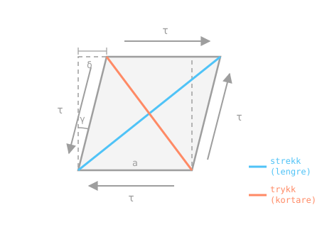

# Skjærmodul frå E-modul og Poissons tal
For eit isotropt material heng stivheten i skjær ($G$) fast med stivheten i strekk ($E$) og tverrkontraksjonen ($\nu$).

---



---

## Formel

$$
\huge G = \dfrac{E}{2 \, (1 + \nu)}
$$

Snudd om:

$$
\large E = 2G(1+\nu) \qquad \nu = \dfrac{E}{2G} - 1
$$

---

## Variabler
$G =$ Skjærmodul ($MPa$ eller $GPa$)
$E =$ Elastisitetsmodul / E-modul ($MPa$ eller $GPa$)
$\nu =$ Poissons tal (dimensjonslaust), tverrkontraksjon / lengdeutviding

$G$ og $E$ får same eining.

---

## Enheter og antagelser
- **Isotropt material** — like egenskapar i alle retningar. Gjeld for metall, dei fleste plastar (uarmert) og gummi.
- **Gjeld ikkje** for tre, fiberkompositt, valsa plater med sterk tekstur, eller 3D-printa delar — der er $G$ ein eigen materialparameter som må slåast opp.
- Lineær elastisk, små deformasjonar (under flytegrensa).
- For isotrope material ligg $0 \le \nu \le 0{,}5$, så $G$ ligg alltid mellom $E/3$ og $E/2$.

| $\nu$ | $G$             | Typisk                     |
| ----- | --------------- | -------------------------- |
| 0     | $E/2$           | Kork (teoretisk grense)    |
| 0,30  | $0{,}385 \, E$  | Stål                       |
| 0,33  | $0{,}376 \, E$  | Aluminium                  |
| 0,5   | $E/3$           | Gummi (inkompressibelt)    |

**Tommelfingerregel for metall:** $G \approx 0{,}38 \cdot E$, altså litt under 40 % av E-modulen.

---

## Intuitiv forklaring — kvifor formelen ser slik ut

### 1) Kva skjærmodulen er
E-modulen seier kor mykje eit material strekkjer seg: $\sigma = E \cdot \varepsilon$.
Skjærmodulen seier kor mykje det *skyv seg skeivt*: $\tau = G \cdot \gamma$, der $\gamma$ er vinkelendringa (i radianar) når eit kvadrat blir til ein rombe (sjå figuren).

Spørsmålet er: kvifor skal desse to henge saman? Skjær og strekk ser jo ut som heilt ulike ting.

### 2) Nøkkelinnsikta: skjær *er* strekk og trykk, berre vridd 45°
Sjå på figuren. Når kvadratet blir skyvd skeivt, blir den eine diagonalen **lengre** (blå) og den andre **kortare** (oransje). Ein kan ikkje forlenge noko utan strekk — så eit element i rent skjær $\tau$ er nøyaktig det same som:

- **strekk** $\sigma_1 = +\tau$ langs den eine diagonalen, og
- **trykk** $\sigma_2 = -\tau$ langs den andre.

Dette ser ein i praksis:

- **Sprø material** (støypejern, kritt, herda stål) som blir vridd til brot, ryk langs ei **45° skruelinje** — dei sviktar i strekk, og strekket går på skrå.
- **Tynnvegga ting** (brusboks, tynne platesteg i bjelkar) som blir vridd eller skjæra, får **skrå bulkar** — det er trykkdiagonalen som knekk.
- **Duktile material** (bløtt stål, aluminium) ryk derimot **tvert av**, fordi dei sviktar i sjølve skjæret.

### 3) Kor mykje blir diagonalen lengre? — her kjem $(1+\nu)$
Strekkdiagonalen får to bidrag:

1. Strekket langs diagonalen drar han ut: $\dfrac{\tau}{E}$
2. Trykket *på tvers* klemmer elementet saman i den andre retninga — og pga. Poisson-effekten bulnar det då ut i strekkretninga: $\nu \cdot \dfrac{\tau}{E}$

Begge drar same veg, så dei legg seg saman:

$$
\large \varepsilon_{diagonal} = \dfrac{\tau}{E} + \nu\dfrac{\tau}{E} = \dfrac{\tau}{E}(1+\nu)
$$

Det er det $(1+\nu)$ betyr: **trykket i den eine retninga hjelper strekket i den andre**. Difor er materialet mjukare i skjær enn ein kanskje skulle tru.

### 4) Kor stor er vinkelen? — her kjem $2$
Rein geometri: sida $a$ blir skyvd $\delta = a \cdot \gamma$. Diagonalen er $a\sqrt{2}$ lang og blir forlenga med ca. $\delta \cos 45° = \dfrac{a\gamma}{\sqrt{2}}$:

$$
\large \varepsilon_{diagonal} = \dfrac{a\gamma / \sqrt{2}}{a\sqrt{2}} = \dfrac{\gamma}{2}
$$

Altså: **diagonalen tøyer seg berre halvparten av skjærvinkelen**. Ein liten diagonal-tøyning gir dobbelt så stor vinkelendring.

### 5) Set saman

$$
\large \dfrac{\gamma}{2} = \dfrac{\tau}{E}(1+\nu) \quad \Rightarrow \quad \dfrac{\tau}{\gamma} = \dfrac{E}{2(1+\nu)} = G
$$

**Oppsummert:**

- **$2$-talet** er geometri — diagonalen får berre halve skjærvinkelen som tøyning.
- **$(1+\nu)$** er material — Poisson-effekten frå trykkdiagonalen gjer at strekkdiagonalen blir enno lengre.

Begge gjer materialet mjukare i skjær, og difor er $G$ alltid godt under $E$.

---

## Typiske verdiar

| Material              | $E$ (GPa) | $\nu$ | $G$ (GPa) |
| --------------------- | --------- | ----- | --------- |
| Stål (konstruksjon)   | 210       | 0,30  | 81        |
| Rustfritt (304/316)   | 193–200   | 0,29  | 75–77     |
| Aluminium             | 70        | 0,33  | 26        |
| Titan (Ti-6Al-4V)     | 114       | 0,34  | 43        |
| Kopar                 | 117       | 0,34  | 44        |
| Messing               | 100       | 0,34  | 37        |
| POM (acetal)          | 3,0       | 0,35  | 1,1       |
| Gummi                 | 0,01–0,1  | ≈0,5  | $\approx E/3$ |

Verdiane er omtrentlege. Som for E-modulen endrar herding og legering $G$ lite.

---

## Eksempel

**1) Stål:**

$E = 210\,000 \, MPa$, $\nu = 0{,}30$

$G = \dfrac{210\,000}{2 \cdot (1 + 0{,}30)} = \dfrac{210\,000}{2{,}6} \approx 80\,800 \, MPa \approx 81 \, GPa$

**2) Stål vs. aluminium i torsjon:** Aluminium har ca. 1/3 av E-modulen til stål — og sidan $\nu$ er nesten lik, også ca. 1/3 av skjærmodulen ($26/81 = 0{,}32$).
Ein aluminiumsaksel med same dimensjon og moment vrir seg altså ca. **3 gonger så mykje** som ein stålaksel. Sjå [Vridning av aksel](vridning-aksel.md).

**3) Kvifor $\nu$ ikkje bør reknast tilbake frå $E$ og $G$:**
Med $E = 70 \, GPa$ og $G = 26 \, GPa$: $\nu = \dfrac{70}{2 \cdot 26} - 1 = 0{,}35$.
Med $G = 27 \, GPa$ i staden: $\nu = 0{,}30$.
4 % endring i $G$ gir 15 % endring i $\nu$ — formelen er god for å finne $G$, men sensitiv i motsett retning.

---

## For copy/paste

**Markdown / Latex:**
```Markdown
$$
G = \dfrac{E}{2 \, (1 + \nu)}
$$
```

**Excel / kalkulator:**
```
=E/(2*(1+nu))
```
