# Bjelkeformlar — nedbøying og bøyespenning

Ferdige formlar for **opplagerkrefter**, **maks bøyemoment** og **maks nedbøying** for dei vanlegaste kombinasjonane av opplagring og last. Bøyespenninga finn du frå momentet med $\sigma = M/W$.

**Framgangsmåte:**

1. Finn tilfellet som passar i tabellane under.
2. Rekn ut $M_{max}$ og $\delta_{max}$.
3. Spenning: $\sigma_{max} = M_{max} / W$. Samanlikn med tillaten spenning.
4. Samanlikn $\delta_{max}$ med kravet til nedbøying.

**Vil du sleppe å rekne for hand?** [Bjelkekalkulatoren](../calculators/bjelkekalkulator.md) brukar formlane her, med standard stålprofil eller eigne mål. $I$ og $W$ for stålprofil finn du i [Ståltabeller](../reference/staalprofiler-tabeller.md).

---

## Symbol

| Symbol            | Tyding                                                              | Eining (N-mm-systemet) |
| ----------------- | ------------------------------------------------------------------- | ---------------------- |
| $F$               | Punktlast                                                            | N                      |
| $q$               | Jamt fordelt last (kraft per lengde)                                 | N/mm                   |
| $q_0$             | Største verdi av trekantlast                                         | N/mm                   |
| $M_0$             | Påført moment                                                        | Nmm                    |
| $L$               | Spennvidde / lengde                                                  | mm                     |
| $a$, $b$          | Avstand frå opplager til last ($a + b = L$)                          | mm                     |
| $x$               | Posisjon langs bjelken                                               | mm                     |
| $R_A$, $R_B$      | Opplagerkrefter (positiv oppover)                                    | N                      |
| $M_A$, $M_B$      | Innspenningsmoment                                                   | Nmm                    |
| $M_{max}$         | Største bøyemoment (talverdi)                                        | Nmm                    |
| $\delta_{max}$    | Største nedbøying                                                    | mm                     |
| $E$               | E-modul — sjå [Material-egenskaper](../reference/material-egenskaper.md) | MPa = N/mm²        |
| $I$               | Arealmoment 2. orden — sjå [Treghetsmoment og motstandsmoment](treghetsmoment-motstandsmoment.md) | mm⁴ |
| $W$               | Motstandsmoment — tabellverdiar i [Ståltabeller](../reference/staalprofiler-tabeller.md) | mm³ |

**Einingar:** Bruk **N, mm og MPa** gjennom heile utrekninga, så kjem momentet ut i Nmm, spenninga i MPa og nedbøyinga i mm. Hugs at 1 kN/m = 1 N/mm. Stål: $E \approx 210\,000$ MPa. Aluminium: $E \approx 70\,000$ MPa.

**I illustrasjonane:** oransje = last, stipla blå linje = forma på nedbøyinga (overdriven). Trekant med skravur = fast ledd, trekant på rullar = glidelager, skravert vegg = fast innspenning.

---

## Frå moment til spenning

$$\Large \boxed{\sigma_{max} = \dfrac{M_{max}}{W} = \dfrac{M_{max} \cdot c}{I}}$$

$c =$ avstand frå nøytralaksen til ytterfiber. Spenninga er strekk på den eine sida og trykk på den andre.

Momentet avheng berre av last og opplagring. Nedbøyinga avheng i tillegg av stivleiken $EI$:

- Dobbel lengde gir **2×** spenning og **8×** nedbøying ved punktlast ($L^3$), og **4×** spenning og **16×** nedbøying ved fordelt last ($L^4$).
- Høgfast stål gir høgare tillaten spenning, men **ikkje** mindre nedbøying — E-modulen er den same.

**Skjærspenning** er som regel liten i slanke bjelkar, men sjekk han for korte bjelkar med stor last nær opplageret. Største skjærkraft $V$ er lik den største opplagerkrafta (for overheng: den største av $F$ og $R_A$). Rektangel: $\tau_{max} = 1{,}5 \cdot V/A$. Massiv aksel: $\tau_{max} = \frac{4}{3} \cdot V/A$.

---

## Fritt opplagt bjelke

Ledd i den eine enden og glidelager i den andre. Endane kan rotere fritt.

| Lasttilfelle | Opplagerkrefter | Bøyemoment | Nedbøying |
| --- | --- | --- | --- |
| **1 — Punktlast i midten** 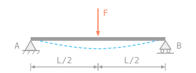 | $R_A = R_B = \dfrac{F}{2}$ | $M_{max} = \dfrac{F L}{4}$ under lasta | $\delta_{max} = \dfrac{F L^3}{48 E I}$ i midten |
| **2 — Punktlast på vilkårleg plass** 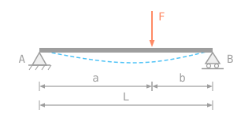 | $R_A = \dfrac{F b}{L}$ $R_B = \dfrac{F a}{L}$ | $M_{max} = \dfrac{F a b}{L}$ under lasta | Under lasta: $\delta_F = \dfrac{F a^2 b^2}{3 E I L}$ Maks (når $a \ge b$): $\delta_{max} = \dfrac{F b \,(L^2 - b^2)^{3/2}}{9 \sqrt{3}\, E I L}$ ved $x = \sqrt{\dfrac{L^2 - b^2}{3}}$ frå A |
| **3 — To like punktlaster, symmetrisk** 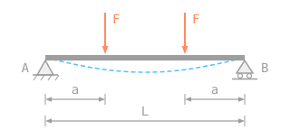 | $R_A = R_B = F$ | $M_{max} = F a$ konstant mellom lastene | $\delta_{max} = \dfrac{F a \,(3 L^2 - 4 a^2)}{24 E I}$ i midten |
| **4 — Jamt fordelt last** 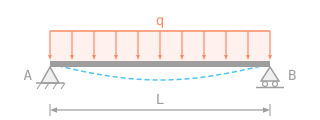 | $R_A = R_B = \dfrac{q L}{2}$ | $M_{max} = \dfrac{q L^2}{8}$ i midten | $\delta_{max} = \dfrac{5 q L^4}{384 E I}$ i midten |
| **5 — Trekantlast** 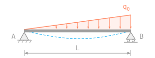 | $R_A = \dfrac{q_0 L}{6}$ $R_B = \dfrac{q_0 L}{3}$ | $M_{max} = \dfrac{q_0 L^2}{9 \sqrt{3}} = 0{,}0642\, q_0 L^2$ ved $x = 0{,}577 L$ frå A | $\delta_{max} = 0{,}00652\, \dfrac{q_0 L^4}{E I}$ ved $x = 0{,}519 L$ frå A |
| **6 — Moment i enden** 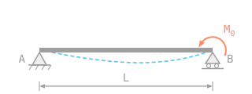 | $R_A = \dfrac{M_0}{L}$ $R_B = -\dfrac{M_0}{L}$ (nedover) | $M_{max} = M_0$ ved B | $\delta_{max} = \dfrac{M_0 L^2}{9 \sqrt{3}\, E I}$ ved $x = 0{,}577 L$ frå A |

I tilfelle 2 ligg største nedbøying alltid nær midten av bjelken, sjølv når lasta står langt ute mot den eine sida. For $a < b$: byt om $a$ og $b$ og mål $x$ frå B.

---

## Utkragar

Fast innspent i A, fri i den andre enden. Største moment er alltid ved innspenninga, og største nedbøying er i den frie enden.

| Lasttilfelle | Opplagerkrefter | Bøyemoment | Nedbøying |
| --- | --- | --- | --- |
| **7 — Punktlast i enden** 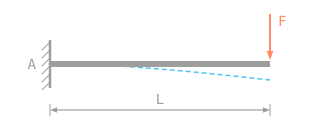 | $R_A = F$ | $M_{max} = M_A = F L$ | $\delta_{max} = \dfrac{F L^3}{3 E I}$ |
| **8 — Punktlast på vilkårleg plass** 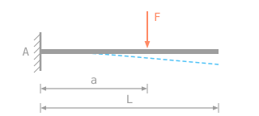 | $R_A = F$ | $M_{max} = M_A = F a$ | I enden: $\delta_{max} = \dfrac{F a^2 (3L - a)}{6 E I}$ Under lasta: $\delta_F = \dfrac{F a^3}{3 E I}$ |
| **9 — Jamt fordelt last** 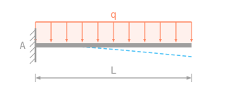 | $R_A = q L$ | $M_{max} = M_A = \dfrac{q L^2}{2}$ | $\delta_{max} = \dfrac{q L^4}{8 E I}$ |
| **10 — Trekantlast, størst ved innspenninga** 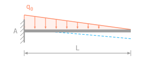 | $R_A = \dfrac{q_0 L}{2}$ | $M_{max} = M_A = \dfrac{q_0 L^2}{6}$ | $\delta_{max} = \dfrac{q_0 L^4}{30 E I}$ |
| **11 — Moment i enden** 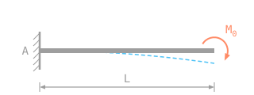 | $R_A = 0$ | $M_{max} = M_0$ konstant langs heile bjelken | $\delta_{max} = \dfrac{M_0 L^2}{2 E I}$ |

Ei «fast innspenning» er aldri heilt stiv i praksis. Ei sveist eller bolta innfesting gir litt etter, så verkeleg nedbøying blir gjerne noko større enn utrekna.

---

## Fast innspent i begge endar

Begge endane er låste mot rotasjon. Det gir mykje stivare bjelke, men også moment i innfestingane.

| Lasttilfelle | Opplagerkrefter | Bøyemoment | Nedbøying |
| --- | --- | --- | --- |
| **12 — Punktlast i midten** 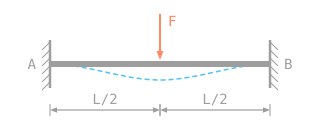 | $R_A = R_B = \dfrac{F}{2}$ | $M_{max} = \dfrac{F L}{8}$ både ved innspenningane og under lasta | $\delta_{max} = \dfrac{F L^3}{192 E I}$ i midten |
| **13 — Punktlast på vilkårleg plass** 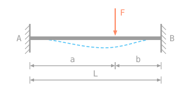 | $R_A = \dfrac{F b^2 (3a + b)}{L^3}$ $R_B = \dfrac{F a^2 (a + 3b)}{L^3}$ | $M_A = \dfrac{F a b^2}{L^2}$ $M_B = \dfrac{F a^2 b}{L^2}$ Under lasta: $M_F = \dfrac{2 F a^2 b^2}{L^3}$ | Under lasta: $\delta_F = \dfrac{F a^3 b^3}{3 E I L^3}$ Maks (når $a \ge b$): $\delta_{max} = \dfrac{2 F a^3 b^2}{3 E I (3a + b)^2}$ ved $x = \dfrac{2 a L}{3a + b}$ frå A |
| **14 — Jamt fordelt last** 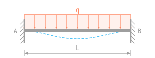 | $R_A = R_B = \dfrac{q L}{2}$ | $M_{max} = \dfrac{q L^2}{12}$ ved innspenningane $\dfrac{q L^2}{24}$ i midten | $\delta_{max} = \dfrac{q L^4}{384 E I}$ i midten |

I tilfelle 13 er det største momentet ved innspenninga som er **nærmast** lasta ($M_B$ når $a > b$).

---

## Innspent i den eine enden, fritt opplagt i den andre

Fast innspent i A og glidelager i B.

| Lasttilfelle | Opplagerkrefter | Bøyemoment | Nedbøying |
| --- | --- | --- | --- |
| **15 — Punktlast i midten** 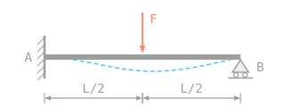 | $R_A = \dfrac{11 F}{16}$ $R_B = \dfrac{5 F}{16}$ | $M_{max} = M_A = \dfrac{3 F L}{16}$ Under lasta: $\dfrac{5 F L}{32}$ | $\delta_{max} = \dfrac{F L^3}{48 \sqrt{5}\, E I} = \dfrac{F L^3}{107 E I}$ ved $x = 0{,}447 L$ frå B |
| **16 — Jamt fordelt last** 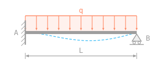 | $R_A = \dfrac{5 q L}{8}$ $R_B = \dfrac{3 q L}{8}$ | $M_{max} = M_A = \dfrac{q L^2}{8}$ I feltet: $\dfrac{9 q L^2}{128}$ ved $x = \dfrac{3L}{8}$ frå B | $\delta_{max} = \dfrac{q L^4}{185 E I}$ ved $x = 0{,}422 L$ frå B |

---

## Fritt opplagt med overheng

Bjelken stikk ut forbi opplager B. Typisk for ein aksel med reimskive eller tannhjul utanfor lageret.

| Lasttilfelle | Opplagerkrefter | Bøyemoment | Nedbøying |
| --- | --- | --- | --- |
| **17 — Punktlast i enden av overhenget** 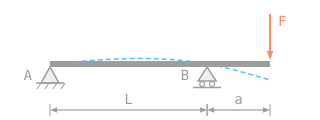 | $R_A = -\dfrac{F a}{L}$ (nedover) $R_B = \dfrac{F (L + a)}{L}$ | $M_{max} = F a$ ved B | I enden: $\delta_{max} = \dfrac{F a^2 (L + a)}{3 E I}$ Mellom opplagera (oppover): $\delta = \dfrac{F a L^2}{9 \sqrt{3}\, E I}$ ved $x = 0{,}577 L$ frå A |

Opplager A må kunne ta kraft **nedover**. Kort avstand $L$ mellom opplagera gir store lagerkrefter.

---

## Samanlikning av opplagringar

Same bjelke, same spennvidde og same last. Tala viser kor mykje opplagringa har å seie.

| Opplagring                    | $M_{max}$ punktlast i midten/enden | $\delta_{max}$ punktlast | $M_{max}$ jamt fordelt | $\delta_{max}$ jamt fordelt |
| ----------------------------- | ---------------------------------- | ------------------------ | ---------------------- | --------------------------- |
| Utkragar                      | $FL$                               | $FL^3 / 3EI$             | $qL^2 / 2$             | $qL^4 / 8EI$                |
| Fritt opplagt                 | $FL / 4$                           | $FL^3 / 48EI$            | $qL^2 / 8$             | $qL^4 / 76{,}8EI$           |
| Innspent + fritt opplagt      | $FL / 5{,}33$                      | $FL^3 / 107EI$           | $qL^2 / 8$             | $qL^4 / 185EI$              |
| Fast innspent i begge endar   | $FL / 8$                           | $FL^3 / 192EI$           | $qL^2 / 12$            | $qL^4 / 384EI$              |

Ein fast innspent bjelke er **4–5 gonger stivare** enn ein fritt opplagt, og ein utkragar er **16 gonger mjukare** enn ein fritt opplagt bjelke med same lengde og punktlast.

---

## Superposisjon

Så lenge materialet er elastisk og nedbøyinga er lita, kan fleire laster på same bjelke reknast kvar for seg og leggjast saman:

$$\Large \delta_{tot} = \delta_1 + \delta_2 + \dots \qquad M_{tot}(x) = M_1(x) + M_2(x) + \dots$$

- Nedbøying og moment må leggjast saman **i same punkt**. Maksverdiane kan berre summerast direkte når dei ligg på same stad (t.d. punktlast i midten + eigenvekt). Elles gir summen av maksverdiane eit svar på trygg side.
- **Eigenvekt** blir rekna som jamt fordelt last: $q = m' \cdot g$, der $m'$ er masse per lengde. Døme: 10 kg/m → $q = 0{,}098$ N/mm.

---

## Føresetnader

Formlane byggjer på klassisk bjelketeori (Euler–Bernoulli):

- Lineært elastisk materiale — spenninga er under flytegrensa.
- Rett bjelke med **konstant tverrsnitt** ($EI$ konstant).
- Små nedbøyingar i forhold til lengda.
- Slank bjelke, $L/h$ over ca. 10. For korte, høge bjelkar kjem skjærdeformasjon i tillegg, og verkeleg nedbøying blir større.
- Lasta verkar gjennom skjærsenteret, vinkelrett på bjelken, i eit hovudplan. Inga vriding og inga aksialkraft.
- Bjelken vippar ikkje. Høge, smale tverrsnitt og opne profil (I, U) utan sideavstiving kan vippe før spenninga når flyt.
- Statisk last. Ved støt og dynamisk last blir påkjenninga større.

**Krav til nedbøying** avheng av bruken. Tommelfingerverdiar: $L/200$–$L/300$ for bygg og generelle stålkonstruksjonar, $L/500$–$L/1000$ for maskinrammer og kranbaner, og ofte hundredels millimeter for akslar med tannhjul. Bruk kravet frå gjeldande standard der det finst.

---

## Eksempel

### 1) Fritt opplagt IPE 100 med punktlast i midten
Spennvidde $L = 2000$ mm, last $F = 5$ kN i midten. IPE 100: $I = 1{,}71 \cdot 10^6$ mm⁴, $W = 34\,200$ mm³, masse 8,1 kg/m.

**Moment** (tilfelle 1):
$M_{max} = \dfrac{F L}{4} = \dfrac{5000 \cdot 2000}{4} = 2{,}5 \cdot 10^6 \, Nmm$

**Spenning:**
$\sigma_{max} = \dfrac{M_{max}}{W} = \dfrac{2{,}5 \cdot 10^6}{34\,200} = 73 \, MPa$

**Nedbøying:**
$\delta_{max} = \dfrac{F L^3}{48 E I} = \dfrac{5000 \cdot 2000^3}{48 \cdot 210\,000 \cdot 1{,}71 \cdot 10^6} = 2{,}3 \, mm \quad (= L/860)$

**Eigenvekt** (tilfelle 4): $q = 8{,}1 \cdot 9{,}81 / 1000 = 0{,}079$ N/mm
$\delta = \dfrac{5 q L^4}{384 E I} = \dfrac{5 \cdot 0{,}079 \cdot 2000^4}{384 \cdot 210\,000 \cdot 1{,}71 \cdot 10^6} = 0{,}05 \, mm$
$\sigma = \dfrac{q L^2}{8 W} = \dfrac{0{,}079 \cdot 2000^2}{8 \cdot 34\,200} = 1{,}2 \, MPa$

Begge maksverdiane ligg i midten, så dei kan summerast: $\delta_{tot} \approx 2{,}4$ mm og $\sigma_{tot} \approx 74$ MPa. Eigenvekta har lite å seie her.

### 2) Utkraga aksel Ø30 med last i enden
Stålaksel Ø30 mm stikk 200 mm ut frå innfestinga. Last $F = 1000$ N i enden.

$I = \dfrac{\pi d^4}{64} = \dfrac{\pi \cdot 30^4}{64} = 39\,760 \, mm^4 \qquad W = \dfrac{\pi d^3}{32} = \dfrac{\pi \cdot 30^3}{32} = 2651 \, mm^3$

**Moment** (tilfelle 7):
$M_{max} = F L = 1000 \cdot 200 = 200\,000 \, Nmm$

**Spenning:**
$\sigma_{max} = \dfrac{200\,000}{2651} = 75 \, MPa$

**Nedbøying:**
$\delta_{max} = \dfrac{F L^3}{3 E I} = \dfrac{1000 \cdot 200^3}{3 \cdot 210\,000 \cdot 39\,760} = 0{,}32 \, mm$

---

## Relatert
- [Bjelkekalkulator](../calculators/bjelkekalkulator.md) — reknar nedbøying, moment og spenning med formlane her
- [Ståltabeller](../reference/staalprofiler-tabeller.md) — $I$, $W$ og masse for IPE, HE-A, HE-B, hulprofil, rør, U og L
- [Treghetsmoment og motstandsmoment](treghetsmoment-motstandsmoment.md) — $I$ og $W$ for vanlege tverrsnitt
- [Material-egenskaper](../reference/material-egenskaper.md) — E-modul og flytegrense
- [Knekking / Buckling](knekking.md) — når bjelken har trykkraft langs aksen
- [Vridning av aksel](../formulas/vridning-aksel.md)

*Illustrasjonane er laga med `app/beam_diagrams.py`, som også kontrollreknar formlane i tabellane numerisk.*
