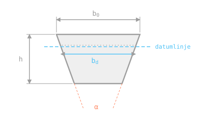

# Kilereimer

Kilereima overfører moment med friksjon mellom flankane på reima og sporet i skiva. Kileforma pressar reima inn i sporet, og det gir mykje større friksjonskraft enn ei flat reim med same strekk.

Notatet har to bruksområde:

1. **Design** — velje profil, skiver, lengde og tal på reimar.
2. **Reverse engineering** — identifisere ei gammal reim eller reimskive og finne erstatning.

Dimensjonering for alvor skal gjerast mot tabellane til produsenten (Optibelt, Gates, ContiTech, Fenner, SKF …). Verdiane her er gode nok til å velje riktig storleik og sjekke at det går opp.

---

## Profil — mål og omgrep

| Mål          | Tyding                                                                          |
| ------------ | ------------------------------------------------------------------------------- |
| $b_0$        | Toppbreidde på reima                                                             |
| $h$          | Høgde på reima                                                                   |
| $b_d$        | **Datumbreidde** — breidda i sporet der reima «verkar». Ligg ved strekkstrengen. |
| $d_d$        | **Datumdiameter** — diameteren på skiva ved datumbreidda. All utrekning brukar denne. |
| $d_a$        | Ytterdiameter på skiva (det du kan måle med skyvelære)                           |
| $\alpha$     | Sporvinkel i skiva (32°–38°)                                                     |

Eldre namn: datum = **wirksam** (DIN, $b_w$, $d_w$, $L_w$) = **pitch** (US, $L_p$).

---

## Standardar og typar

| Type                             | Profil                         | Standard                  | Bruk                                    |
| -------------------------------- | ------------------------------ | ------------------------- | --------------------------------------- |
| Klassisk kilereim                | Y, Z, A, B, C, D, E            | DIN 2215, ISO 4184        | Eldre maskiner, landbruk, lett industri |
| Smalkilereim                     | SPZ, SPA, SPB, SPC             | DIN 7753, ISO 4184        | **Standard i Europa i dag.** Ca. 1,5–2× effekt av klassisk med same breidde |
| Fortanna (cogged) smalkilereim   | XPZ, XPA, XPB, XPC             | DIN 7753 / ISO 4184       | Same skiver som SP, mindre min. diameter, høgare effekt |
| Fortanna klassisk                | ZX, AX, BX, CX                 |                           | Same skiver som klassisk                |
| US klassisk                      | A, B, C, D, E                  | RMA / ASTM                | Ca. same mål som ISO A–E                |
| US smalkilereim                  | 3V, 5V, 8V (3VX, 5VX fortanna) | RMA / ASTM                | US-ekvivalent til SP-serien             |
| US lett drift (FHP)              | 2L, 3L, 4L, 5L                 | RMA                       | Små maskiner, plenklippar, verkstadmaskiner |
| Kraftband (banded)               | t.d. 3/SPB                     |                           | Fleire reimar bunde saman — mot vibrasjon og at reimar hoppar av |
| Ribbereim / Poly-V               | PH, PJ, PK, PL, PM             | ISO 9982, DIN 7867        | Bil, kvitevarer, kompakte driftar        |
| Dobbel kilereim (hexagonal)      | AA, BB, CC                     |                           | Serpentin-drift, reim på begge sider    |
| Variatorreim (breibands)         | t.d. 30x10, 37x11              |                           | Trinnlause variatorar, scooter / CVT    |

---

## Profilmål — smalkilereimer (SP / XP)

| Profil | $b_0$ (mm) | $h$ (mm) | $b_d$ (mm) | $d_{d,min}$ SP (mm) | $d_{d,min}$ XP (mm) | Maks. fart |
| ------ | ---------- | -------- | ---------- | ------------------- | ------------------- | ---------- |
| SPZ    | 9,7        | 8        | 8,5        | 63                  | 56                  | 40 m/s     |
| SPA    | 12,7       | 10       | 11         | 90                  | 71                  | 40 m/s     |
| SPB    | 16,3       | 13       | 14         | 140                 | 112                 | 40 m/s     |
| SPC    | 22         | 18       | 19         | 224                 | 180                 | 40 m/s     |

## Profilmål — klassiske kilereimer

| Profil | $b_0$ (mm) | $h$ (mm) | $b_d$ (mm) | $d_{d,min}$ (mm) | Kortnemning | Maks. fart |
| ------ | ---------- | -------- | ---------- | ---------------- | ----------- | ---------- |
| Y      | 6          | 4        | 5,3        | 28               | 6×4         | 30 m/s     |
| Z      | 10         | 6        | 8,5        | 50               | 10×6        | 30 m/s     |
| A      | 13         | 8        | 11         | 75               | 13×8        | 30 m/s     |
| B      | 17         | 11       | 14         | 125              | 17×11       | 30 m/s     |
| C      | 22         | 14       | 19         | 200              | 22×14       | 30 m/s     |
| D      | 32         | 19       | 27         | 355              | 32×19       | 30 m/s     |
| E      | 38         | 23       | 32         | 500              | 38×23       | 30 m/s     |

## Profilmål — US (tommar)

| Profil | $b_0$             | $h$               | Nærmaste ISO        |
| ------ | ----------------- | ----------------- | ------------------- |
| 3L     | 3/8" (9,5 mm)     | 7/32" (5,6 mm)    | ≈ Z (lett drift)    |
| 4L     | 1/2" (12,7 mm)    | 5/16" (7,9 mm)    | ≈ A (lett drift)    |
| 5L     | 21/32" (16,7 mm)  | 3/8" (9,5 mm)     | ≈ B (lett drift)    |
| A      | 1/2" (12,7 mm)    | 5/16" (7,9 mm)    | A                   |
| B      | 21/32" (16,7 mm)  | 13/32" (10,3 mm)  | B                   |
| C      | 7/8" (22,2 mm)    | 17/32" (13,5 mm)  | C                   |
| D      | 1 1/4" (31,8 mm)  | 3/4" (19 mm)      | D                   |
| 3V     | 3/8" (9,5 mm)     | 5/16" (8 mm)      | ≈ SPZ               |
| 5V     | 5/8" (15,9 mm)    | 17/32" (13,5 mm)  | ≈ SPB               |
| 8V     | 1" (25,4 mm)      | 7/8" (23 mm)      | ingen direkte       |

Verdiane er nominelle og varierer litt mellom produsentar. 3V/5V og SPZ/SPB er **nesten** like. Dei går ofte i kvarandre sine skiver, men er ikkje formelt utbytbare. FHP-reimer (3L–5L) er ikkje laga for full industriell belastning.

### Kjenneteikn: klassisk eller smal?

$\Large \dfrac{h}{b_0} \approx 0{,}6 \quad \text{(klassisk)} \qquad \dfrac{h}{b_0} \approx 0{,}8 \quad \text{(smal / SP)}$

Z og SPZ har nesten same toppbreidde (10 vs 9,7 mm). **Mål høgda:** 6 mm = Z, 8 mm = SPZ.

### Kompatibilitet mellom skiver
Klassisk og smal profil med same bokstav har **same datumbreidde** ($b_d$): Z/SPZ = 8,5, A/SPA = 11, B/SPB = 14, C/SPC = 19.
- Ei **SP-skive** kan normalt køyre ei klassisk reim med same datumbreidde (SPA-skive ↔ A-reim).
- Ei SP-reim i ei klassisk skive er dårlegare: sporet er grunnare, så reima ligg høgt. Det går ofte i praksis, men sjekk at reima ikkje stikk meir enn litt over kanten.
- XP-reimer går i vanlege SP-skiver.

---

## Lengdebetegnelsar

Det er her det oftast går gale. Ei reim har tre lengder:

| Symbol             | Lengde                                   | Brukt for                         |
| ------------------ | ---------------------------------------- | --------------------------------- |
| $L_i$              | Innvendig lengde                          | Klassiske reimer (Z, A, B, C …)   |
| $L_d$ ($L_w$, $L_p$) | Datumlengde — langs datumlinja           | **SP/XP-reimer**, all utrekning   |
| $L_a$ ($L_o$)      | Utvendig lengde                           | US 3V/5V/8V, 3L/4L/5L             |

### Omrekning

**Klassisk:** $L_d = L_i + \Delta$

| Profil       | Z   | A   | B   | C   | D   | E   |
| ------------ | --- | --- | --- | --- | --- | --- |
| $\Delta$ (mm) | 22  | 30  | 40  | 58  | 75  | 80  |

**Smal:** $L_a = L_d + \Delta$

| Profil       | SPZ | SPA | SPB | SPC |
| ------------ | --- | --- | --- | --- |
| $\Delta$ (mm) | 13  | 18  | 22  | 30  |

Verdiane varierer ±3 mm mellom produsentar. Bakgrunnen er at $L_a - L_d \approx 2\pi \cdot$ (avstand frå datumlinja til topp på reima).

### Korleis lese merkinga

| Merking            | Tyding                                                       |
| ------------------ | ------------------------------------------------------------ |
| `SPA 1250`         | SPA-profil, $L_d$ = 1250 mm                                   |
| `SPA 1250 Lw`      | Same — Lw = wirksam = datum                                   |
| `XPB 1500`         | Fortanna SPB, $L_d$ = 1500 mm                                 |
| `A 42` / `A42`     | Klassisk A, $L_i$ = 42" = 1067 mm                             |
| `13x1050 Li`       | Klassisk A (13 mm brei), $L_i$ = 1050 mm                      |
| `B 1250 Ld`        | Klassisk B, **datumlengde** 1250 mm — sjekk alltid Li/Ld!     |
| `4L420`            | US lett drift 1/2", utvendig lengde 42,0"                     |
| `5V800`            | US smal 5/8", utvendig lengde 80,0"                           |
| `3VX500`           | Fortanna 3V, utvendig lengde 50,0"                            |
| `3/SPB 2000`       | Kraftband, 3 SPB-reimer bunde saman, $L_d$ = 2000 mm          |
| `6PK1200`          | Ribbereim, 6 ribber, PK-profil, effektiv lengde 1200 mm       |

---

## Reimskiver — sporvinkel og datumdiameter

Sporvinkelen blir mindre på små skiver. Det er fordi reima blir breiare på innsida når ho bøyer seg rundt ei lita skive, så flankevinkelen hennar minkar.

| Profil      | 34° ved $d_d \le$ | 38° ved $d_d >$ | $b$ — datum til ytterkant (mm) |
| ----------- | ----------------- | --------------- | ------------------------------ |
| Z / SPZ     | 80                | 80              | 2,0                            |
| A / SPA     | 118               | 118             | 2,75                           |
| B / SPB     | 190               | 190             | 3,5                            |
| C / SPC     | 315               | 315             | 4,8                            |
| D           | 36° ≤ 500         | 500             | 8,1                            |
| E           | 36° ≤ 630         | 630             | 9,6                            |

**Frå ytterdiameter til datumdiameter:**

$\Large d_d = d_a - 2b$

**Standard datumdiametrar** (R20/R40-serie, mm):
63 · 67 · 71 · 75 · 80 · 85 · 90 · 95 · 100 · 106 · 112 · 118 · 125 · 132 · 140 · 150 · 160 · 170 · 180 · 190 · 200 · 212 · 224 · 236 · 250 · 265 · 280 · 300 · 315 · 335 · 355 · 375 · 400 · 425 · 450 · 500 · 560 · 630 · 710 · 800 · 900 · 1000

### Taper Lock-bossingar
Dei fleste moderne skiver brukar Taper Lock-bossing. Nummeret har formatet **AABB**: AA ≈ maks boring i tidels tomme, BB ≈ lengde i tidels tomme.

| Bossing | Maks boring ca. (mm) | Lengde (mm) |
| ------- | -------------------- | ----------- |
| 1008    | 25                   | 22          |
| 1108    | 28                   | 22          |
| 1210    | 32                   | 25          |
| 1610    | 42                   | 25          |
| 2012    | 50                   | 32          |
| 2517    | 65                   | 45          |
| 3020    | 75                   | 51          |
| 3525    | 90                   | 65          |

---

## Formlar

### Moment og effekt

$\Large M = \dfrac{9550 \cdot P}{n}$

$M =$ Moment (Nm), $P =$ Effekt (kW), $n =$ Turtal (o/min)

### Utveksling

$\Large i = \dfrac{n_1}{n_2} = \dfrac{d_{d2}}{d_{d1}}$

Indeks 1 = drivande skive (motor), 2 = driven skive. Bruk **datumdiameter**. Reell slure er ca. 1–2 %, så driven aksel går litt saktare enn utrekna.

### Reimfart

$\Large v = \dfrac{\pi \cdot d_{d1} \cdot n_1}{60\,000}$

$v =$ Reimfart (m/s), $d_{d1}$ i mm, $n_1$ i o/min.
Optimalt område er ca. 15–30 m/s. Under ca. 5 m/s blir reimkrafta stor (sjå $F_e$ under), så det trengst mange reimar. Over 30 (klassisk) / 40 (smal) m/s blir sentrifugalkrafta for stor.

### Effektiv reimkraft (trekkraft)

$\Large F_e = F_1 - F_2 = \dfrac{2M}{d_d} = \dfrac{P}{v}$

$F_1 =$ Kraft i stram part, $F_2 =$ Kraft i slakk part (N)
Med $M$ i Nm og $d_d$ i m, eller $P$ i W og $v$ i m/s.

### Kvifor kileforma gir grep
Forholdet mellom stram og slakk part følgjer same formel som tau rundt ein pullert (sjå [Tau friksjon](../formulas/tau-friksjon.md)), men med ein «effektiv» friksjonskoeffisient:

$\Large \dfrac{F_1}{F_2} = e^{\mu' \beta} \qquad \mu' = \dfrac{\mu}{\sin(\alpha/2)}$

Med $\alpha = 38°$ blir $\sin 19° \approx 0{,}33$, så **kileforma gir ca. 3 gonger så høg friksjon** som ei flat reim. Difor kan kilereimer gå med lågare forspenning og mindre omslutning.

### Akselbelastning

$\Large F_{aksel} \approx (1{,}5 - 2) \cdot F_e$

Grovt anslag ved korrekt forspenning. Det er viktig for lager og for utkraga motoraksel — hald skiva så nær lageret som mogleg.

### Reimlengde (open drift)

$\Large L_d \approx 2C + \dfrac{\pi}{2}(d_{d1} + d_{d2}) + \dfrac{(d_{d2} - d_{d1})^2}{4C}$

$C =$ Senteravstand (mm)

### Senteravstand frå reimlengde

$\Large C = \dfrac{k + \sqrt{k^2 - 8(d_{d2} - d_{d1})^2}}{8} \qquad k = 2L_d - \pi(d_{d1} + d_{d2})$

Anbefalt: $\; 0{,}7(d_{d1} + d_{d2}) \le C \le 2(d_{d1} + d_{d2})$

Set av justeringsrom: ca. **−1,5 %** av $L_d$ for montering, og **+3 %** for etterstramming.

### Omslutningsvinkel på lita skive

$\Large \beta \approx 180° - 57{,}3° \cdot \dfrac{d_{d2} - d_{d1}}{C}$

Bør vere over ca. 120°. Lågare vinkel gir mindre kapasitet per reim, sjå $c_1$ under.

---

## Dimensjonering — framgangsmåte

Metoden følgjer DIN 2218 / ISO 5292, som er det same alle produsentkatalogar brukar.

**1) Dimensjonerande effekt**

$\Large P_B = P \cdot c_2$

| Drift                                                | $c_2$ ca. (8–16 t/døgn) |
| ---------------------------------------------------- | ------------------------ |
| Lett — vifter, sentrifugalpumper, transportband lett | 1,1                      |
| Middels — kompressorar (skrue), verktøymaskiner, sager | 1,2                    |
| Tung — stempelkompressorar, kverner, heisar          | 1,4                      |
| Svært tung — knusarar, hamarmøller, valseverk       | 1,6                      |

Legg til ca. +0,1 ved drift over 16 t/døgn, og trekk frå ca. 0,1 ved under 8 t/døgn. Bruk høgare verdi for motor med høgt startmoment eller direktestart med mykje masse.

**2) Vel profil**
Ut frå $P_B$ og turtalet til den **minste** skiva, i diagram frå produsent. Grov rettleiing ved ca. 1450 o/min:

| $P_B$ (kW) | Typisk profil |
| ---------- | ------------- |
| < 3        | SPZ (eller Z) |
| 3 – 15     | SPZ / SPA     |
| 10 – 40    | SPA / SPB     |
| 30 – 150   | SPB / SPC     |
| > 150      | SPC           |

Ved lågare turtal kan det trengast ein profil større.

**3) Vel skiver**
Lita skive **så stor som plassen tillèt**, og minst $d_{d,min}$. Ei større skive gir høgare reimfart, lågare reimkraft og lengre levetid. Finn stor skive frå utvekslinga, og rund av til standard diameter.

**4) Senteravstand og reimlengde**
Vel $C$, rekn $L_d$, vel nærmaste standardlengde og rekn ut $C$ på nytt.

**5) Tal på reimar**

$\Large z = \dfrac{P_B}{P_N \cdot c_1 \cdot c_3}$

$P_N =$ Nominell effekt per reim (produsenttabell, avheng av profil, $d_{d1}$, $n_1$ og $i$)
$c_1 =$ Vinkelfaktor (omslutning)
$c_3 =$ Lengdefaktor (kortare reim = fleire bøyingar per minutt = lågare faktor, typisk 0,8–1,1)

| $\beta$ | 180° | 170° | 160° | 150° | 140° | 130° | 120° | 110° | 100° | 90°  |
| ------- | ---- | ---- | ---- | ---- | ---- | ---- | ---- | ---- | ---- | ---- |
| $c_1$   | 1,00 | 0,98 | 0,95 | 0,92 | 0,89 | 0,86 | 0,82 | 0,78 | 0,73 | 0,68 |

**Grov kapasitet per reim** ($P_N$, ca. 1450 o/min på lita skive, $i \approx 1{,}5$):

| Profil | $d_{d1}$ (mm) | $P_N$ ca. (kW) |
| ------ | ------------- | -------------- |
| SPZ    | 100           | 2,2            |
| SPA    | 125           | 3,5            |
| SPA    | 160           | 5,5            |
| SPB    | 200           | 10             |
| SPC    | 315 (970 o/min) | 25           |
| A      | 125           | 2,0            |
| B      | 180           | 4,5            |

Berre for å sjekke at svaret er rimeleg — bruk produsenttabell til endeleg val.

---

## Montering og vedlikehald

- **Byt alle reimer i eit sett samtidig**, og bruk same merke og same produksjonsparti (matched set). Nye og gamle reimer deler ikkje lasta jamt.
- **Ikkje lirk reima på** over kanten på skiva — slakk av motoren. Lirking skadar strekkstrengen.
- **Linjering:** skivene skal stå i flukt, maks ca. 0,5° vinkelfeil. Sjekk med linjal eller laser over begge skivene.
- **Forspenning, tommelfingerregel:** nedbøying ca. **16 mm per meter** spennlengde (1/64 av spennet), med testkraft frå produsenten midt på spennet. For slakk reim gir slure og varme. For stram reim gir lager- og akselbrot.
- **Etterstramming:** etter ca. 30 min – 4 timar køyring. Nye reimer set seg.
- **Slitne spor:** reima skal ikkje gå på botnen av sporet, og blanke flanker / blank botn tyder på slitt skive. Sporsjablong er billeg.
- Reimer som pip ved start betyr som regel slakk reim eller overlast.

---

## Reverse engineering — framgangsmåte

**1) Les merkinga** på reima om det går (sjå tabell over). Pass på kva lengde som er oppgitt — Li, Ld eller La.

**2) Mål reima:** toppbreidde $b_0$ og høgde $h$.
- Bruk $h/b_0$ for å skilje klassisk (≈ 0,6) frå smal (≈ 0,8).
- Gamle reimer er slitne og flatare — rund opp mot nærmaste profil.

**3) Mål sporet på skiva:**
- Toppbreidde på sporet ≈ $b_0$ for reima.
- Sporvinkel 34°–38° (sjablong eller vinkelmålar).
- Skiver med djupe spor = SP-profil, grunne = klassisk.
- US-maskiner (tommemål på boring, kilespor i tommar) har gjerne 3L/4L/5L eller A/B.

**4) Finn datumdiameter:**

$d_d = d_a - 2b$ → rund av til nærmaste standard datumdiameter.

**5) Finn reimlengde** utan reim:
- Mål senteravstand $C$ med reima stramma, og rekn ut $L_d$ med formelen over.
- Eller: legg eit målband / snor rundt skivene i sporet ved datumlinja.
- Eller: mål den gamle reima utvendig med målband og trekk frå $\Delta$.

**6) Kontroller:** stemmer turtal og utveksling med det maskina skal gjere? Er profilen stor nok for motoreffekten?

---

## Eksempel

### 1) Design: skruekompressor
Motor 5,5 kW, 1450 o/min. Kompressoren skal gå ca. 900 o/min. Senteravstand ca. 400 mm.

**Dimensjonerande effekt:** $P_B = 5{,}5 \cdot 1{,}2 = 6{,}6 \, kW$ → SPA

**Moment på motoraksel:**
$M = \dfrac{9550 \cdot 5{,}5}{1450} = 36{,}2 \, Nm$

**Skiver:** $d_{d1} = 125 \, mm$
$d_{d2} = 125 \cdot \dfrac{1450}{900} = 201$ → standard **200 mm** → $n_2 = 1450 \cdot \dfrac{125}{200} = 906 \, o/min$

**Reimfart:**
$v = \dfrac{\pi \cdot 125 \cdot 1450}{60\,000} = 9{,}5 \, m/s$ ✓

**Reimkraft:**
$F_e = \dfrac{P}{v} = \dfrac{5500}{9{,}5} = 580 \, N$ (kontroll: $\dfrac{2 \cdot 36{,}2}{0{,}125} = 579 \, N$ ✓)
Akselbelastning ca. $1{,}5-2 \times 580 \approx 900-1200 \, N$

**Lengde:**
$L_d = 2 \cdot 400 + \dfrac{\pi}{2}(125 + 200) + \dfrac{75^2}{4 \cdot 400} = 800 + 510{,}5 + 3{,}5 = 1314 \, mm$ → vel **SPA 1320**

**Ny senteravstand:**
$k = 2 \cdot 1320 - \pi \cdot 325 = 1619$
$C = \dfrac{1619 + \sqrt{1619^2 - 8 \cdot 75^2}}{8} = \dfrac{1619 + 1605}{8} = 403 \, mm$

**Omslutning:**
$\beta = 180° - 57{,}3° \cdot \dfrac{75}{403} = 169°$ → $c_1 \approx 0{,}98$

**Tal på reimar:** $P_N \approx 3{,}5 \, kW$, $c_3 \approx 0{,}93$
$z = \dfrac{6{,}6}{3{,}5 \cdot 0{,}98 \cdot 0{,}93} = 2{,}07$ → **3 reimar**

Med $d_{d1} = 140$ i staden (og $d_{d2} = 224$) aukar $P_N$ til ca. 4,3 kW, og **2 reimar** er nok. Ei større skive er ofte billegare enn ei ekstra reim.

### 2) Reverse engineering: gammal reimskive
Skive utan reim. Ytterdiameter $d_a = 137{,}5 \, mm$. Sporet er ca. 12,7 mm breitt i toppen og djupt.

- Breidde 12,7 og djupt spor → **SPA** (eller A).
- $d_d = 137{,}5 - 2 \cdot 2{,}75 = 132 \, mm$ → standard 132 ✓
- Sporvinkel: $d_d = 132 > 118$ → skal vere 38°. Mål for å sjekke.
- Motorskiva er tilsvarande $d_d = 90$, og senteravstanden er 350 mm:

$L_d = 700 + \dfrac{\pi}{2}(90 + 132) + \dfrac{42^2}{1400} = 700 + 348{,}7 + 1{,}3 = 1050 \, mm$ → **SPA 1060** eller **SPA 1032** avhengig av justeringsrom.

Om det skal vere klassisk A-reim: $L_i = L_d - 30 = 1020 \, mm$ → ca. **A 40** (1016 mm).

---

## Relatert
- [Tau friksjon](../formulas/tau-friksjon.md) — same eksponentielle friksjonslov som reim på skive
- [Turtal i elektromotor](../formulas/turtal-elektromotor.md)
- [Vridning av aksel](../formulas/vridning-aksel.md)
