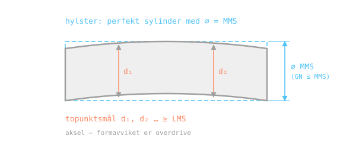
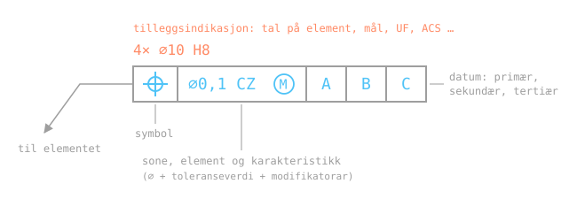
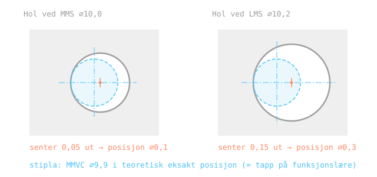

# Toleransesetting — ISO GPS

Korleis toleransar på ei teikning skal skrivast og lesast etter ISO GPS (Geometrical Product Specifications). Notatet er laga for oppslag: finn spørsmålet i tabellen under, eller bruk innhaldslista til høgre.

| Eg lurer på …                                                    | Gå til                                                             |
| ---------------------------------------------------------------- | ------------------------------------------------------------------ |
| Kva tyder M, L eller R i sirkel i toleranseramma?                | [Materialkrav](#materialkrav-mmr-lmr-og-rpr)                       |
| Kor mykje «bonustoleranse» får eg?                               | [Rekne ut MMVS og bonus](#rekne-ut-virtuell-storleik)              |
| Kva tyder E i sirkel bak eit mål?                                | [Envelope-kravet](#envelope-kravet)                                |
| Kva blir eigentleg målt når det står ⌀20 ±0,1?                   | [Måltoleransar](#maltoleransar-liner-storleik)                    |
| Kva tyder GG, GX, GN, LP, ACS … bak eit mål?                     | [Modifikatorar for storleik](#modifikatorar-for-storleik)          |
| Kva tyder symbolet i toleranseramma?                             | [Dei 14 geometriske symbola](#dei-geometriske-symbola)             |
| Kva tyder CZ, UZ, UF, P i sirkel … i ramma?                      | [Modifikatorar i toleranseramma](#modifikatorar-i-toleranseramma)  |
| Kvifor er målet i ei firkanta ramme?                             | [TED](#teoretisk-eksakte-mal-ted)                                  |
| Kor stor posisjonstoleranse kan eit klaringshol ha?              | [Klaringshol for skruar](#klaringshol-for-skruar)                  |
| Kva toleranse har eit mål utan toleranse?                        | [Generelle toleransar](#generelle-toleransar-iso-2768-1)           |
| Kva må stå i tittelfeltet?                                       | [Tittelfeltet](#tittelfeltet)                                      |
| Teikninga er gammal eller amerikansk                             | [Eldre notasjon](#eldre-notasjon) og [ISO mot ASME](#iso-mot-asme) |

---

## Grunnreglane

Fire reglar forklarer det meste av det som kjem etterpå.

| Regel | Tyding | Kjelde |
| ----- | ------ | ------ |
| **Uavhengigheitsprinsippet** | Kvart krav på teikninga gjeld for seg sjølv. Ein måltoleranse avgrensar **ikkje** form, retning eller plassering. Samanheng mellom krav må skrivast inn med t.d. E, M, L eller CZ. | ISO 8015, ISO 14405-2 kap. 4 |
| **Topunktsmål er standard** | Eit mål utan modifikator er eit topunktsmål: avstanden mellom to motståande punkt, slik du måler med mikrometer. Alle topunktsmål på elementet skal liggje innanfor grensene. | ISO 14405-1, 6.2 |
| **Eitt heilt element** | Eit krav gjeld eitt enkelt, heilt element (éi flate, eitt hol) om ikkje anna er skrive (n×, CZ, UF, avgrensa område). | ISO 14405-1 regel P, ISO 1101 kap. 6 |
| **Plassering ⊃ retning ⊃ form** | Ein plasseringstoleranse avgrensar òg retning og form på elementet. Ein retningstoleranse avgrensar òg form, men ikkje plassering. Ein formtoleranse avgrensar berre form. | ISO 1101, 4.8 |

!!! warning "Måltoleransen held ikkje akselen rett"
    Ein aksel ⌀20 h7 utan fleire krav kan vere krum som ein banan og likevel vere godkjend, så lenge kvart topunktsmål ligg mellom 19,979 og 20,000. Skal akselen gå inn i eit hol, treng han E eller ein geometrisk toleranse.

I tillegg gjeld (ISO 8015): måla gjeld ved 20 °C, og delen blir rekna som stiv om ikkje anna er skrive.

---

## Omgrep

| Omgrep (engelsk) | Tyding |
| ---------------- | ------ |
| **Storleikselement** (feature of size) | Geometri som har ein storleik: **sylinder**, **kule** eller **to parallelle motståande plan** (lineær storleik), **kjegle** eller **kile** (vinkelstorleik). Berre desse kan ha måltoleranse utan tvetyding. |
| **Integralelement** (integral feature) | Ei verkeleg flate eller linje på delen. |
| **Avleidd element** (derived feature) | Akse, midtplan eller senterpunkt — avleidd frå eit storleikselement. |
| **Utvendig / innvendig** | Utvendig = aksel, tapp, tjukn. Innvendig = hol, spor. |
| **Topunktsmål** (two-point size) | Avstand mellom to motståande punkt. Eit lokalt mål — det finst uendeleg mange på eitt element. |
| **Globalt mål** | Éin verdi for heile elementet, t.d. diameteren på den minste sylinderen som går utanpå akselen. |
| **TED** | Teoretisk eksakt mål, skrive i firkanta ramme. Har ingen toleranse. |
| **TEF** | Teoretisk eksakt element: den ideelle geometrien toleransesona blir lagd rundt. |
| **Datum** | Ideelt plan, akse eller punkt som toleransesoner blir plasserte ut frå. |
| **MMS** | Maksimum materialstorleik: delen har **mest** materiale. Største aksel, minste hol. |
| **LMS** | Minimum materialstorleik: delen har **minst** materiale. Minste aksel, største hol. |
| **MMVS / MMVC** | Maksimum material virtuell storleik / tilstand. Sjå [materialkrav](#materialkrav-mmr-lmr-og-rpr). |
| **LMVS / LMVC** | Minimum material virtuell storleik / tilstand. |

---

## Måltoleransar (lineær storleik)

Kjelde: ISO 14405-1:2025. Gjeld sylinder, kule og to parallelle motståande plan.

### Skrivemåtar

| Skrivemåte | Døme | Merknad |
| ---------- | ---- | ------- |
| Nominelt mål og grenseavvik | 55 ±0,2 &nbsp;·&nbsp; ⌀38 0/−0,1 &nbsp;·&nbsp; 150 +0,2/0 | Ulike avvik skal stå på to linjer, øvre avvik øvst. Avvik lik null står utan forteikn. |
| Nominelt mål og toleransekode | ⌀67 k6 &nbsp;·&nbsp; 100 h8 &nbsp;·&nbsp; 165 js10 | Koden er definert i ISO 286-1. Likeverdig med å skrive grensene. |
| Øvre og nedre grense | ⌀38,2 over ⌀37,9 | To linjer, øvre grense øvst. |
| Berre éi grense | 85,2 max. &nbsp;·&nbsp; 84,8 min. | |
| Berre nominelt mål | 10 | Generell toleranse gjeld, dersom tittelfeltet viser til ein standard for det. |

Symbol framfor målet: **⌀** for sylinder og sirkel, **S⌀** for kule, ingenting for to parallelle plan. Det er ikkje mellomrom mellom ⌀ og talet, men mellomrom mellom talet og avviket.

Mål i parentes er hjelpemål, og mål i firkanta ramme er [TED](#teoretisk-eksakte-mal-ted). Ingen av dei har toleranse.

### Modifikatorar for storleik

Utan modifikator gjeld topunktsmål. Ein modifikator bak målet endrar kva som skal målast. Modifikatoren står i avlang ramme.

| Modifikator | Namn (engelsk) | Tyding |
| ----------- | -------------- | ------ |
| LP | Topunktsmål (two-point size) | Standard. Treng ikkje skrivast. |
| LS | Kulemål (spherical size) | Diameteren på den største kula som får plass i tverrsnittet. |
| GG | Minste kvadrats mål (least-squares size) | Diameteren på den best tilpassa sylinderen. Det ei koordinatmålemaskin normalt gir. |
| GX | Største innskrivne mål (maximum inscribed size) | Største perfekte element som får plass **inni**. For hol: største tapp som går inn. |
| GN | Minste omskrivne mål (minimum circumscribed size) | Minste perfekte element som går **utanpå**. For aksel: minste hol akselen går inn i. |
| GC | Minimax-mål (Chebyshev size) | Elementet som gir minst mogleg største avvik. |
| CC | Omkrinsdiameter | $d = C/\pi$, der $C$ er omkrinsen i tverrsnittet. |
| CA | Arealdiameter | $d = \sqrt{4A/\pi}$, der $A$ er arealet i tverrsnittet. |
| CV | Volumdiameter | $d = \sqrt{4V/(\pi L)}$. |
| SX | Største mål | Den største av dei lokale måla. |
| SN | Minste mål | Den minste av dei lokale måla. |
| SA | Gjennomsnittsmål | Gjennomsnittet av dei lokale måla. |
| SM | Medianmål | Medianen av dei lokale måla. |
| SD | Midtmål (mid-range size) | Middelverdien av største og minste lokale mål. |
| SR | Spreiing (range of sizes) | Største minus minste lokale mål. Skrivast utan nominelt mål: talet er øvre grense. |
| SQ | Standardavvik | Standardavviket til dei lokale måla. Skrivast utan nominelt mål: talet er øvre grense. |

LP og LS er lokale mål. GG, GX, GN, GC og CV er globale mål. CC og CA gjeld per tverrsnitt. SX–SQ er statistiske mål som blir rekna ut frå eit sett lokale mål.

!!! note "SD er ikkje standardavvik"
    I ISO 14405-1 tyder SD midtmål. Standardavvik er SQ.

**Tilleggsmodifikatorar:**

| Symbol | Tyding | Døme |
| ------ | ------ | ---- |
| E | [Envelope-kravet](#envelope-kravet) | 10 ±0,1 E |
| /lengd | Gjeld kvar del av elementet med denne lengda | ⌀10 ±0,1 GG /5 |
| ACS | Kvart tverrsnitt (any cross-section) | ⌀10 ±0,1 GX ACS |
| SCS[A] | Eitt bestemt tverrsnitt, plassert med TED og merkt med bokstav | 10 ±0,1 GX SCS[A] |
| ALS | Kvart lengdesnitt (any longitudinal section) | |
| n× | Gjeld n element kvar for seg | 2× 10 ±0,1 E |
| CT | Fleire element rekna som eitt felles tolerert element | CT2× 10 ±0,1 E |
| UF | Fleire delflater rekna som eitt samansett element (united feature) | UF3× ⌀10 ±0,1 GN |
| A ↔ B | Gjeld berre mellom A og B | A ↔ B ⌀10 ±0,1 |

**Rekkjefølgje:** mål og toleranse → éin modifikator for typen mål (eller E) → snitt eller lengd → statistisk modifikator → eventuelt filter og retningselement. n×, UF, CT og A ↔ B står **framfor** eller over målet.

**Døme:**

| Skrive på teikninga | Tyding |
| ------------------- | ------ |
| ⌀20 h7 | Kvart topunktsmål skal liggje mellom 19,979 og 20,000. |
| ⌀20 h7 GG | Diameteren på den best tilpassa sylinderen skal liggje mellom 19,979 og 20,000. |
| ⌀12 ±0,05 GG ACS SX | Finn minste kvadrats diameter i kvart tverrsnitt. Den største av dei skal liggje mellom 11,95 og 12,05. |
| ⌀12 ±0,05 ACS SD | I kvart tverrsnitt skal midtmålet av topunktsmåla liggje mellom 11,95 og 12,05. |
| 0,004 SR | Skilnaden mellom største og minste topunktsmål skal vere høgst 0,004. |

Fleire krav til same mål kan stablast over kvarandre, venstrejusterte. Kvart krav gjeld då for seg. Skal øvre og nedre grense ha ulik målemetode, skal det skrivast som to stabla krav.

**Endre standarden for heile teikninga:** skriv i eller ved tittelfeltet «Linear size ISO 14405» og modifikatoren, t.d. «Linear size ISO 14405 GG».

---

## Envelope-kravet

Kjelde: ISO 14405-1:2025, kap. 9. Symbol: E bak måltoleransen.

Envelope-kravet er to krav i eitt, og knyter form til storleik:

| | Aksel (utvendig) | Hol (innvendig) |
| --- | --- | --- |
| **Maksimum materialgrense** | Minste omskrivne mål GN ≤ øvre grense | Største innskrivne mål GX ≥ nedre grense |
| **Minimum materialgrense** | Kvart topunktsmål ≥ nedre grense | Kvart topunktsmål ≤ øvre grense |

Sagt på ein annan måte: elementet skal ikkje bryte gjennom eit perfekt hylster med storleik lik MMS, og ingen stad skal det vere tynnare (aksel) eller vidare (hol) enn LMS.

**Døme — aksel ⌀20 h7 E** (grenser 19,979 og 20,000):

- Akselen skal gå inn i ein perfekt sylinder ⌀20,000 over heile lengda.
- Kvart topunktsmål skal vere minst 19,979.
- Er akselen 20,000 overalt, må han vere heilt rett og rund. Er han 19,979 overalt, kan han vere inntil 0,021 krum.

**Bruk:**

- Passningar, altså alt som skal gå inn i noko anna. Eit ISO-passningspar (t.d. H7/g6) gir berre den klaringa tabellen lovar når begge delane har E.
- Kontroll følgjer Taylor-prinsippet: GÅ-sida er ei lære med full form og full lengd, STOPP-sida er eit topunktsmål.
- Envelope-kravet seier ingenting om retning eller plassering i forhold til andre element.
- Det kan ikkje brukast på vinkelstorleikar (ISO 14405-3).
- Skal det gjelde alle mål på teikninga: skriv «Linear size ISO 14405 E» ved tittelfeltet.

---

## Mål som ikkje er storleik

Kjelde: ISO 14405-2:2018.

Eit ± mål er berre eintydig på eit storleikselement. For alle andre mål er det uklart kva som skal målast på ein verkeleg del med formavvik, og standarden rår frå å bruke ± der. Bruk geometrisk toleranse i staden.

| Type mål | Tvetydig med ± | Eintydig løysing |
| -------- | -------------- | ---------------- |
| Trinnhøgd, avstand mellom to flater som vender same veg | 20 ±0,1 | Datum på den eine flata, posisjon eller flateprofil på den andre, avstanden som TED |
| Avstand mellom to flater som ikkje er eit storleikselement | 50 ±0,1 | Same |
| Avstand frå flate til holsenter | 15 ±0,1 | Datum på flata, posisjon på holet, avstanden som TED |
| Senteravstand mellom to hol | 40 ±0,1 | Posisjon på begge hola med CZ, eller eitt hol som datum |
| Radius | R5 ±0,2 | Flateprofil med radiusen som TED |
| Holplassering i to retningar | x ±0,1 og y ±0,1 | Posisjon med sylindrisk sone (⌀), eller to posisjonskrav med ulik verdi |
| Fas og kantavrunding | 2 ±0,2 × 45° | Profil, eller ISO 13715 for kantar |

Einingar: lineære mål er i millimeter, og eininga blir ikkje skriven. Vinklar skal alltid ha eining, både på målet og på toleransen.

---

## Vinkelmål

Kjelde: ISO 14405-3:2016. Gjeld kjegle og kile (to plan som ikkje er parallelle, med materialet på motsett side).

- Skrivemåte: 35° ±1°, 35° +1°/−2°, 36° over 34°, 45° max.
- Standard utan modifikator er **tolinjemål med minimax-tilpassing**: i kvart snitt blir det lagt ei rett linje til kvar side, og vinkelen mellom dei skal liggje innanfor grensene. Forma på flatene er altså ikkje avgrensa.

| Modifikator | Tyding |
| ----------- | ------ |
| LC | Tolinjemål, minimax. Standard. |
| LG | Tolinjemål, minste kvadrat. |
| GG | Globalt vinkelmål, minste kvadrat. |
| GC | Globalt vinkelmål, minimax. |
| SX SN SA SM SD SR SQ | Statistiske mål, same tyding som for lineær storleik. |

---

## Geometriske toleransar

Kjelde: ISO 1101:2017.

Ein geometrisk toleranse definerer ei **toleransesone** som elementet skal liggje innanfor. Innanfor sona kan elementet ha kva form, retning og plassering som helst.

### Toleranseramma

Ramma blir lesen frå venstre: **symbol** → **sone, element og karakteristikk** → **datum**. Formtoleransar har ikkje datumfelt.

Døme: ⌖⌀0,1AB tyder: aksen til elementet skal liggje i ein sylinder med diameter 0,1, plassert teoretisk eksakt i forhold til datum A (primær) og B (sekundær).

**Kvar pila peikar avgjer kva som er tolerert:**

| Pila peikar … | Tolerert element |
| ------------- | ---------------- |
| på flata eller ei hjelpelinje frå ho, tydeleg unna mållinja | Sjølve flata |
| i forlenginga av mållinja til eit storleikselement | Det avleidde elementet: akse, midtplan eller senterpunkt |
| på flata, med A i ramma | Aksen eller senterpunktet. Berre for rotasjonsflater. |

**Standard for toleransesona:**

- Sona ligg symmetrisk om det teoretisk eksakte elementet.
- Toleranseverdien er breidda på sona, målt vinkelrett på den nominelle geometrien.
- **⌀** framfor verdien gir sylindrisk eller sirkulær sone. **S⌀** gir kuleforma sone. Utan symbol er sona to parallelle plan eller linjer.
- Kravet gjeld heile elementet.
- Ein geometrisk toleranse avgrensar ikkje formavviket på datumelementet.

### Dei geometriske symbola

| Type | Karakteristikk (engelsk) | Symbol | Datum | Toleransesone |
| ---- | ------------------------ | ------ | ----- | ------------- |
| Form | Rettheit (straightness) | ⏤ | nei | Linje på flate: to parallelle linjer med avstand t. Akse med ⌀: sylinder ⌀t. |
| Form | Flatheit (flatness) | ⏥ | nei | To parallelle plan med avstand t. |
| Form | Rundheit (roundness) | ○ | nei | I kvart tverrsnitt: to konsentriske sirklar med radiusskilnad t. |
| Form | Sylindrisitet (cylindricity) | ⌭ | nei | To koaksiale sylindrar med radiusskilnad t. |
| Form, retning eller plassering | Linjeprofil (line profile) | ⌒ | valfritt | To linjer som omhyllar sirklar med ⌀t, sentrerte på den teoretisk eksakte linja. |
| Form, retning eller plassering | Flateprofil (surface profile) | ⌓ | valfritt | To flater som omhyllar kuler med ⌀t, sentrerte på den teoretisk eksakte flata. |
| Retning | Parallellitet (parallelism) | // | ja | To plan med avstand t (eller sylinder ⌀t) parallelt med datum. |
| Retning | Vinkelrettheit (perpendicularity) | ⊥ | ja | To plan med avstand t (eller sylinder ⌀t) vinkelrett på datum. |
| Retning | Vinkel (angularity) | ∠ | ja | To plan med avstand t i TED-vinkel til datum. |
| Plassering | Posisjon (position) | ⌖ | ja ¹ | Sone sentrert på den teoretisk eksakte plasseringa, gitt med TED. |
| Plassering | Konsentrisitet (punkt) og koaksialitet (akse) | ◎ | ja | Sirkel eller sylinder ⌀t med senter eller akse på datum. |
| Plassering | Symmetri (symmetry) | ⌯ | ja | To parallelle plan med avstand t, symmetrisk om datum-midtplanet. |
| Kast | Sirkulært kast (circular run-out) | ↗ | ja | Radialt: i kvart tverrsnitt to konsentriske sirklar med radiusskilnad t og senter på datumaksen. Aksialt: i kvar radius to sirklar med aksial avstand t. |
| Kast | Totalkast (total run-out) | ⌰ | ja | Radialt: to koaksiale sylindrar med radiusskilnad t om datumaksen. Aksialt: to parallelle plan med avstand t vinkelrett på datumaksen. |

¹ Posisjon kan stå utan datum når han berre låser fleire element til kvarandre (med CZ).

**Val av symbol — tommelfingerreglar:**

- Sirkulært kast = det måleuret viser på éin stad når delen blir dreidd éin omgang om datumaksen. Totalkast = same, men måleuret blir ført langs heile flata.
- Radialt totalkast avgrensar sylindrisitet og koaksialitet samla. Aksialt totalkast gir same sone som vinkelrettheit på flata.
- Flateprofil er det mest generelle symbolet. Med datum og TED kan han erstatte dei fleste andre krava til ei flate.
- Koaksialitet og symmetri er spesialtilfelle av posisjon der TED-måla er null.

### Teoretisk eksakte mål (TED)

Eit mål i firkanta ramme, t.d. 50 eller 30°, er eit teoretisk eksakt mål.

- TED har ingen toleranse, og generelle toleransar gjeld ikkje for dei.
- TED plasserer og rettar inn toleransesona. Avviket blir fanga opp av den geometriske toleransen som høyrer til.
- Implisitte TED blir ikkje skrivne: 0 mm, 0°, 90°, 180°, 270° og lik deling på ein full sirkel.
- TED kan hentast frå CAD-modellen. Då skal det stå ved tittelfeltet, t.d. «TED's according to CAD model 12345 rev A».

### Modifikatorar i toleranseramma

Modifikatorane står i det andre feltet, etter toleranseverdien, i denne rekkjefølgja.

**Toleransesona:**

| Symbol | Namn | Tyding |
| ------ | ---- | ------ |
| ⌀ / S⌀ | Sylindrisk / kuleforma sone | Står framfor verdien. |
| 0,1–0,2 | Variabel breidd | Sona går lineært frå 0,1 til 0,2 mellom to punkt, som blir gitt med A ↔ B over ramma. |
| 0,1/100 | Avgrensa lengd | Kravet gjeld kvar lengd på 100 mm, kvar som helst på elementet. Areal: /75×50 eller /⌀4. |
| CZ | Kombinert sone (combined zone) | Sonene for fleire element er låste til kvarandre i retning og plassering. Heitte «common zone» før. |
| SZ | Separate soner | Kvart element har si eiga, uavhengige sone. Dette er standard og treng berre skrivast for å gjere det tydeleg. |
| UZ+0,05 | Forskyvd sone | Sona er forskyvd frå den teoretiske flata. + er ut av materialet, − er inn i materialet. Forteiknet skal alltid stå. |
| OZ | Uspesifisert forskyving | Sona kan forskyvast eit konstant, men ukjent stykke. Brukt saman med eit større krav utan OZ. |
| VA | Variabel vinkel | For kjegler der vinkelen ikkje er låst med TED. |
| >< | Berre retning | Datuma låser berre retninga på sona, ikkje plasseringa. |

**Det tolererte elementet:**

| Symbol | Tyding |
| ------ | ------ |
| G0,8- o.l. | Filter: bokstav for filtertype følgd av tal utan mellomrom. ISO har ikkje noko standardfilter. |
| C | Kravet gjeld det tilpassa minimax-elementet, ikkje den verkelege flata. |
| G | Kravet gjeld det tilpassa minste kvadrats elementet. |
| N | Kravet gjeld det minste omskrivne elementet eller aksen til det. Berre storleikselement. |
| X | Kravet gjeld det største innskrivne elementet eller aksen til det. Berre storleikselement. |
| T | Kravet gjeld tangentplanet eller tangentlinja utanpå materialet. |
| A | Kravet gjeld det avleidde elementet (akse eller senterpunkt). |
| P | Projisert toleransesone. Sjå under. |

C, G, N, X og T kan berre brukast på krav med datum.

**Karakteristikken (berre formkrav):**

| Symbol | Tyding |
| ------ | ------ |
| C, CE, CI | Referanseelement: minimax — fri, utanfor materialet, inni materialet. C er standard. |
| G, GE, GI | Referanseelement: minste kvadrat — fri, utanfor materialet, inni materialet. |
| N, X | Referanseelement: minste omskrivne, største innskrivne. |
| T | Parameter: topp til botn. Standard. |
| P, V | Parameter: berre topphøgd, berre dalbotn. |
| Q | Parameter: kvadratisk middelverdi (RMS). |

Bokstavar utan tal er referanseelement eller parameter. Bokstavar følgde av tal er filter.

**Material og tilstand:**

| Symbol | Tyding |
| ------ | ------ |
| M | Maksimum materialkrav. Sjå [materialkrav](#materialkrav-mmr-lmr-og-rpr). |
| L | Minimum materialkrav. |
| R | Resiprositetskrav. Står etter M eller L. |
| F | Fri tilstand, for delar som ikkje er stive (ISO 10579). |

### Rundt og over ramma

| Symbol | Tyding |
| ------ | ------ |
| n× | Kravet gjeld n element. Utan CZ gjeld det kvart for seg. |
| UF | Elementa blir rekna som eitt samansett element med éi sone. |
| ACS | Kravet gjeld i kvart tverrsnitt. Endrar òg datumet til same tverrsnitt. |
| A ↔ B | Kravet gjeld berre mellom A og B. |
| LD, MD, PD | Gjenger og tannhjul: minste diameter, største diameter, delediameter. Krav på gjenger gjeld aksen til delesylinderen om ikkje anna står. |
| Liten sirkel i knekken på tilvisingslinja | Rundt heile konturen (all around). Skal kombinerast med SZ, CZ eller UF. |
| Dobbel sirkel i knekken | Over heile delen (all over). Skal kombinerast med SZ, CZ eller UF. |

Etter ramma kan det stå ein plan- eller retningsindikator: ei lita ramme med eit symbol (//, ⊥, ∠ eller symmetri) og ein datumbokstav.

| Form på indikatoren | Namn | Tyding |
| ------------------- | ---- | ------ |
| Spiss på venstre side | Skjeringsplan (intersection plane) | Kravet gjeld linjer på flata, i plan som ligg slik i forhold til datumet. Brukt for rettheit og linjeprofil. |
| Spiss på begge sider | Orienteringsplan (orientation plane) | Fastset retninga på sona for ein akse eller eit senterpunkt. |
| Pil framfor ramma | Retningselement (direction feature) | Fastset retninga breidda på sona blir målt i. Krevst for rundheit på kjegler. |
| Sirkel framfor ramma | Samleplan (collection plane) | Fastset kva flater «rundt heile» omfattar. |

Fleire krav til same element kan stablast under kvarandre, med den største verdien øvst:

⏥0,2
⏥0,05/100

Tyder: flata skal vere flat innanfor 0,2 totalt og innanfor 0,05 på kvar lengd på 100 mm.

### Projisert toleransesone

P flyttar toleransesona ut av delen, dit det har noko å seie. Typisk bruk er gjenga hol og pressa styrepinnar: skruen eller pinnen står ut av holet, og det er der han skal treffe motparten.

Døme: ⌖⌀0,1 P 25AB tyder at aksen skal liggje i ein sylinder ⌀0,1 som strekkjer seg 25 mm ut frå flata. Lengda kan òg teiknast inn som TED med P framfor verdien.

---

## Datum

Kjelde: ISO 5459. Ikkje kontrollert mot standardteksten, sjå [kjelder](#kjelder).

- Eit datum blir merkt med ein bokstav i ramme, knytt til elementet med ein fylt trekant.
- Trekanten **på flata** eller ei hjelpelinje frå ho: datumet er flata. Trekanten **i forlenginga av mållinja**: datumet er aksen eller midtplanet.
- Rekkjefølgja i ramma avgjer: primærdatum låser flest fridomsgrader, sekundærdatum låser det som står att, og så tertiærdatum. Typisk for ein prismatisk del: 3 punkt, 2 punkt, 1 punkt. ⌖0,1AB og ⌖0,1BA er to ulike krav.
- **A-B** i eitt felt er eit felles datum, t.d. aksen gjennom to lagersete.
- Datumpunkt (datum targets), t.d. A1, A2, A3, blir brukte når berre delar av flata skal vere datum. Vanleg på støypte og smidde delar.
- Vel datum etter funksjon: flatene som styrer delen i samanstillinga.

---

## Materialkrav — MMR, LMR og RPR

Kjelde: ISO 2692. Ikkje kontrollert mot standardteksten, sjå [kjelder](#kjelder).

Eit materialkrav knyter den geometriske toleransen til storleiken på elementet. Dei kan berre brukast på storleikselement, der toleransen gjeld aksen eller midtplanet.

| Symbol | Namn | Brukt for å sikre | Typisk døme |
| ------ | ---- | ----------------- | ----------- |
| ingen | Uavhengig av storleik | Presis plassering uansett storleik | Lagersete, pressmonn, styringar, tannhjul |
| M | Maksimum materialkrav (MMR) | At delane **går saman** | Klaringshol for skruar, flensar, lok, tapp i spor |
| L | Minimum materialkrav (LMR) | **Minste godstjukn** eller minste kantavstand | Hol nær kant, veggtjukn i hylse, nok arbeidsmonn |
| M R eller L R | Resiprositetskrav (RPR) | Same som over, men storleiken får låne av den geometriske toleransen | Når berre den virtuelle grensa tel for funksjonen |

Utan symbol gjeld toleransen uavhengig av storleiken. Det er standard i ISO.

### Rekne ut virtuell storleik

Den virtuelle tilstanden er eit perfekt element som delen ikkje får bryte gjennom. Storleiken er:

$$\text{MMVS} = \text{MMS} \pm t \qquad\qquad \text{LMVS} = \text{LMS} \mp t$$

| | MMS | LMS | MMVS (med M) | LMVS (med L) |
| --- | --- | --- | --- | --- |
| **Aksel** (utvendig) | øvre grense | nedre grense | MMS **+** t | LMS **−** t |
| **Hol** (innvendig) | nedre grense | øvre grense | MMS **−** t | LMS **+** t |

t er den geometriske toleransen som står framfor M eller L.

Huskeregel: den virtuelle tilstanden ligg alltid **utanfor** måltoleransen. Med M ligg han på den sida som gjer samanstillinga trongare. Med L ligg han på den sida som gjer godset tynnare.

### Maksimum materialkrav

Når M står etter toleranseverdien, gjeld desse krava til elementet:

1. Kvart lokalt mål skal liggje innanfor måltoleransen, mellom LMS og MMS.
2. Flata skal ikkje bryte gjennom **MMVC**: eit perfekt element med storleik MMVS.
3. Har ramma datum, står MMVC i teoretisk eksakt retning og plassering i forhold til datuma. Gjeld kravet fleire element, står MMVC-ane òg eksakt i forhold til kvarandre.

**Døme — hol ⌀10 +0,2/0 med** ⌖⌀0,1 MAB

MMS = 10,0 og MMVS = 10,0 − 0,1 = **9,9**. Ein perfekt tapp ⌀9,9 i teoretisk eksakt posisjon skal alltid gå inn i holet.

| Verkeleg hol | Posisjonstoleranse | Av dette «bonus» |
| ------------ | ------------------ | ---------------- |
| ⌀10,00 (MMS) | ⌀0,10 | 0 |
| ⌀10,05 | ⌀0,15 | 0,05 |
| ⌀10,10 | ⌀0,20 | 0,10 |
| ⌀10,20 (LMS) | ⌀0,30 | 0,20 |

$$\text{tilgjengeleg toleranse} = t + |\,\text{verkeleg storleik} - \text{MMS}\,|$$

**Døme — tapp ⌀12 0/−0,1 med** ⊥⌀0,05 MA

MMS = 12,0 og MMVS = 12,0 + 0,05 = **12,05**. Tappen skal gå inn i eit perfekt hol ⌀12,05 som står vinkelrett på A. Ein tapp på ⌀11,9 kan stå 0,15 skeivt.

!!! note "Bonustabellen er ei forenkling"
    Det eigentlege kravet er grensa MMVC, og ho fangar opp storleik, form, retning og plassering samla. Tabellen stemmer når holet har perfekt form. Eit krumt eller ovalt hol har mindre å gå på enn tabellen viser. Ei funksjonslære med tapp lik MMVS kontrollerer kravet direkte.

**Null toleranse:** ⌖⌀0 MAB er lovleg og ofte lurt. Då er MMVS = MMS, og heile toleransen ligg i målet. Eit hol ved MMS må stå perfekt, og eit større hol får tilsvarande meir posisjonstoleranse. Verkstaden kan sjølv fordele mellom storleik og plassering.

### Minimum materialkrav

Når L står etter toleranseverdien:

1. Kvart lokalt mål skal liggje mellom LMS og MMS.
2. Flata skal ikkje bryte gjennom **LMVC**: eit perfekt element med storleik LMVS, som ligg **inni materialet**.
3. LMVC står teoretisk eksakt i forhold til datuma.

**Døme — hol ⌀10 +0,2/0 med** ⌖⌀0,1 LA

LMS = 10,2 og LMVS = 10,2 + 0,1 = **10,3**. Holflata skal alltid liggje innanfor ein perfekt sylinder ⌀10,3 i eksakt posisjon. Då er minste godstjukn til ein kant garantert, uansett storleik på holet.

| Verkeleg hol | Posisjonstoleranse |
| ------------ | ------------------ |
| ⌀10,20 (LMS) | ⌀0,10 |
| ⌀10,10 | ⌀0,20 |
| ⌀10,00 (MMS) | ⌀0,30 |

LMVC ligg inni materialet og kan ikkje kontrollerast med fast lære. Kravet må målast.

### Resiprositetskrav

R står etter M eller L og opnar for byte den andre vegen: den geometriske toleransen som ikkje blir brukt, kan leggjast til måltoleransen.

- Med M R fell kravet om at lokale mål skal halde MMS bort. Grensa på maksimum materialsida er berre MMVC. LMS gjeld framleis.
- Med L R fell LMS-grensa bort på same måte. MMS gjeld framleis.

**Døme:** hol ⌀10 +0,2/0 med ⌖⌀0,1 M RAB. Holet kan vere ned til ⌀9,9 dersom det står perfekt i posisjon. Funksjonen er den same som med ⌀9,9 +0,3/0 og ⌀0 M.

### Materialkrav på datum

M eller L kan òg stå etter ein datumbokstav, når datumelementet er eit storleikselement:

⌖⌀0,2 MAB M

- Datumet blir då ikkje henta frå det verkelege datumelementet, men frå den virtuelle tilstanden til datumelementet.
- Er datumelementet mindre enn den virtuelle tilstanden sin (aksel) eller større (hol), kan delen **flyttast** i forhold til datumet. Det gir meir rom.
- Flyttinga gjeld heile mønsteret samla. Ho er ikkje ein bonus som kan leggjast til kvart hol for seg, og ho endrar ikkje avstanden mellom hola.
- Storleiken på den virtuelle tilstanden til datumelementet er MMS når datumelementet ikkje har eigen geometrisk toleranse med M. Har det ein slik toleranse, er han MMS ± denne toleransen.

### Når materialkrav ikkje passar

- Presspassningar og overgangspassningar.
- Sentrering og styring der plasseringa i seg sjølv er funksjonen: lager, tannhjul, tetningsflater.
- Element som ikkje er storleikselement, t.d. ei enkel flate.
- Kast, rundheit og sylindrisitet.
- Gjenger: klaringa i gjenga er ikkje knytt til eit enkelt mål, så M gir lite. Bruk heller P.

### Klaringshol for skruar

Tommelfingerregel som følgjer direkte av den virtuelle tilstanden. H = minste holdiameter (MMS), F = største skruediameter (MMS), t = posisjonstoleranse med M.

| Tilfelle | Formel | Merknad |
| -------- | ------ | ------- |
| **Gjennomgåande skrue**: klaringshol i begge delane | $t = H - F$ | Gjeld for kvar av delane. |
| **Fast skrue**: gjenga hol eller pinne i den eine delen | $t_1 + t_2 = H - F$ | Summen blir delt mellom dei to delane, ofte likt. Bruk P på den gjenga delen. |

**Døme:** M8-skrue (F = 8,0) i klaringshol ⌀9 H13 (H = 9,0).

- Gjennomgåande: t = 9,0 − 8,0 = ⌀1,0 M på begge delane.
- Fast: ⌀0,5 M på klaringsholet og ⌀0,5 P på gjengeholet.

---

## Generelle toleransar — ISO 2768-1

Kjelde: ISO 2768-1:1989. Gjeld mål **utan** eigen toleranse på delar som er sponskorne eller forma av plate, når tittelfeltet viser til standarden, t.d. «ISO 2768-m».

Gjeld ikkje for hjelpemål i parentes og TED i ramme.

**Lineære mål** (mm):

| Klasse | 0,5–3 | >3–6 | >6–30 | >30–120 | >120–400 | >400–1000 | >1000–2000 | >2000–4000 |
| ------ | ----- | ---- | ----- | ------- | -------- | --------- | ---------- | ---------- |
| **f** fin | ±0,05 | ±0,05 | ±0,1 | ±0,15 | ±0,2 | ±0,3 | ±0,5 | — |
| **m** middels | ±0,1 | ±0,1 | ±0,2 | ±0,3 | ±0,5 | ±0,8 | ±1,2 | ±2 |
| **c** grov | ±0,2 | ±0,3 | ±0,5 | ±0,8 | ±1,2 | ±2 | ±3 | ±4 |
| **v** svært grov | — | ±0,5 | ±1 | ±1,5 | ±2,5 | ±4 | ±6 | ±8 |

Nominelle mål under 0,5 mm skal ha eigen toleranse.

**Brotne kantar** — ytre radius og fashøgd (mm):

| Klasse | 0,5–3 | >3–6 | >6 |
| ------ | ----- | ---- | -- |
| **f** og **m** | ±0,2 | ±0,5 | ±1 |
| **c** og **v** | ±0,4 | ±1 | ±2 |

**Vinklar** — etter lengda på det kortaste vinkelbeinet (mm):

| Klasse | ≤10 | >10–50 | >50–120 | >120–400 | >400 |
| ------ | --- | ------ | ------- | -------- | ---- |
| **f** og **m** | ±1° | ±0°30′ | ±0°20′ | ±0°10′ | ±0°5′ |
| **c** | ±1°30′ | ±1° | ±0°30′ | ±0°15′ | ±0°10′ |
| **v** | ±3° | ±2° | ±1° | ±0°30′ | ±0°20′ |

Verd å vite:

- Vinkeltoleransen gjeld òg vinklar som ikkje er skrivne, t.d. 90°.
- Vinkeltoleransen avgrensar berre hovudretninga til linjene, ikkje formavviket.
- Ein del som går over den generelle toleransen, skal ikkje vrakast automatisk dersom funksjonen ikkje er svekt (kap. 6).
- Dei generelle toleransane svarar til vanleg verkstadnøyaktigheit. Det er ikkje noko å spare på å setje grovare toleranse enn verkstaden held uansett.

**Generelle geometriske toleransar:** ISO 2768-2 (klasse H, K, L, skrive t.d. «ISO 2768-mK») vart trekt tilbake i 2021 og erstatta av ISO 22081. Mange teikningar viser framleis til ISO 2768-mK. Tillegget «-E», som i «ISO 2768-mK-E», tyder at envelope-kravet gjeld alle storleikselement. Verdiane er ikkje tekne med her, sjå [kjelder](#kjelder).

---

## Tittelfeltet

| Tekst i eller ved tittelfeltet | Verknad |
| ------------------------------ | ------- |
| ISO 8015 | Gjer det tydeleg at ISO GPS og uavhengigheitsprinsippet gjeld. |
| ISO 2768-m | Generelle toleransar for mål utan eigen toleranse, klasse m. |
| Linear size ISO 14405 E | Envelope-kravet gjeld alle lineære storleikselement. |
| Linear size ISO 14405 GG | Alle lineære mål er minste kvadrats mål i staden for topunktsmål. |
| Angular size ISO 14405 GG | Same for vinkelmål. |
| ISO 1101 FC: G | Formavvik blir rekna frå minste kvadrats element i staden for minimax. |
| ISO 1101 TF: G0,8-×50- | Standard filter for alle geometriske krav: Gauss, 0,8 mm på opne profil og 50 bølgjer per omdreiing på lukka. |
| TED's according to CAD model … | Mål som ikkje står på teikninga, er TED og blir henta frå modellen. |

---

## Eldre notasjon

Dette finn du på eldre teikningar. Det skal ikkje brukast på nye.

| Eldre skrivemåte | Tyding, og kva som gjeld no |
| ---------------- | --------------------------- |
| Teksten «common zone» ved ramma | No CZ i ramma. |
| Pil frå ramma rett på senterlinja | Kravet gjeld aksen eller midtplanet. No: pil i forlenginga av mållinja. |
| Datumtrekant rett på senterlinja | Datumet er aksen. No: trekant i forlenginga av mållinja. |
| Datumbokstavar utan rekkjefølgje, i same felt | Uklart kva som er primærdatum. No: eitt felt per datum. |
| Ramma kopla rett på datumelementet med linje | No: datumbokstav. |
| LE etter verdien | Kravet gjeld linjeelement. No: skjeringsplanindikator. |
| NC etter verdien | «Ikkje konveks». Utgått utan erstatning. Skriv ein merknad. |
| UZ med hakeparentes, t.d. UZ[+0,05] | No utan parentes. |
| «Rundt heile» utan SZ, CZ eller UF | Tvetydig: nokre las det som éi felles sone, andre som separate. |
| To linjer med ulik modifikator bak eit mål | Øvste linje gjaldt øvre grense, nedste linje nedre grense. No: to stabla krav. |
| /0 bak eit mål | Tyder kvart tverrsnitt. No ACS. |
| CT til høgre for målet | No framfor målet. |
| «Profile any line», «profile any surface» | Gamle namn på linjeprofil og flateprofil. |

---

## ISO mot ASME

Amerikanske teikningar følgjer ASME Y14.5. Symbola er stort sett like, men standardreglane er det ikkje. Ikkje kontrollert mot standardteksten, sjå [kjelder](#kjelder).

| | ISO GPS | ASME Y14.5 |
| --- | --- | --- |
| Form og storleik | Uavhengige. Envelope må skrivast med E. | «Rule #1»: envelope gjeld alltid for storleikselement, om ikkje anna står. |
| Mål utan modifikator | Topunktsmål. | Topunktsmål pluss hylster ved MMC. |
| Materialkrav | M og L gir ei virtuell grense som flata skal halde. | Same symbol. Kan lesast som grense eller som bonus på aksen. |
| Felles sone | CZ. | Ikkje naudsynt: krav med same datum gjeld samla. |
| Koaksialitet og symmetri | Eigne symbol. | Tekne ut i 2018-utgåva. Posisjon, kast eller profil blir brukt. |
| Desimalteikn | Komma. | Punktum. |

Sjekk alltid kva standard teikninga viser til før du les toleransane.

---

## Kjelder

| Standard | Tema | Status i dette notatet |
| -------- | ---- | ---------------------- |
| ISO 14405-1:2025 | Lineær storleik, modifikatorar, envelope | Kontrollert mot standarden |
| ISO 14405-2:2018 | Mål som ikkje er storleik | Kontrollert mot standarden |
| ISO 14405-3:2016 | Vinkelstorleik | Kontrollert mot standarden |
| ISO 1101:2017 | Geometriske toleransar | Kontrollert mot standarden |
| ISO 2768-1:1989 | Generelle toleransar, mål og vinklar | Kontrollert mot standarden |
| ISO 2692 | Materialkrav: MMR, LMR, RPR | **Ikkje kontrollert** |
| ISO 8015 | Grunnprinsipp | **Ikkje kontrollert** |
| ISO 5459 | Datum | **Ikkje kontrollert** |
| ISO 286-1 | Toleransekodar og passningar | **Ikkje kontrollert** |
| ISO 2768-2 / ISO 22081 | Generelle geometriske toleransar | **Ikkje kontrollert** |
| ASME Y14.5 | Amerikansk standard | **Ikkje kontrollert** |

Relatert: [Presspassninger og tykkvegga rør](presspassninger-og-tykkvegga-rør.md) · [Overflateruhet — neseradius og mating](../formulas/overflateruhet-dreiing.md)
