# Ståltabeller – tverrsnittsdata for stålprofiler

**Relatert**

- [Bjelkekalkulator](../calculators/bjelkekalkulator.md) – regner nedbøying, moment og spenning direkte med profilene i disse tabellene.
- [Bjelkeformlar](../notes/bjelkeformlar.md) – formler for nedbøying og bøyespenning ved ulike opplagringer.
- [Treghetsmoment og motstandsmoment](../notes/treghetsmoment-motstandsmoment.md) – hva I og W betyr, og hvordan de regnes ut.
- [Knekking](../notes/knekking.md) – bruker I og treghetsradius i fra tabellene.

**Slik leser du tabellene**

- Desimaltegn er punktum.
- Skaleringen står i enheten under symbolet: `10⁶ mm⁴` betyr at tabellverdien skal ganges med 10⁶ for å få mm⁴. Boken skriver det samme som «I·10⁻⁶ mm⁴». Eksempel: IPE 200 har Iy = 19.4, altså 19.4·10⁶ mm⁴ (= 1940 cm⁴).

## Symboler

| Symbol | Betydning |
| :-- | :-- |
| A | Tverrsnittsareal |
| Iy, Iz | Annet arealmoment (treghetsmoment) om y–y og z–z |
| Wy, Wz | Elastisk tverrsnittsmodul (motstandsmoment), W = I / største kantavstand |
| iy, iz | Treghetsradius, i = √(I/A) |
| Wp | Plastisk tverrsnittsmodul |
| IT | Torsjonstreghetsmoment (St. Venant) |
| Sy | Statisk moment av halve tverrsnittet om y–y (= Wp,y/2) |
| Cw | Hvelvingskonstant |
| e, ey, ez | Avstand fra ytterkant til tyngdepunktsaksen, se figurene |
| ys | Avstand fra tyngdepunktet til skjærsenteret (SS) |
| ξ–ξ, η–η | Hovedakser for vinkelprofil (Iξ størst, Iη minst) |
| w, w1, w2, w3 | Hullavstand / kantavstand for skruehull |
| d, d1, d2 | Største hulldiameter |

Masse er regnet med 7850 kg/m³, altså masse [kg/m] = 7.85 · A [10³ mm²].

## Innhold

- Tabell 1.1 – Varmvalsede IPE-bjelker
- Tabell 1.2 – Varmvalsede HE-A-bjelker
- Tabell 1.3 – Varmvalsede HE-B-bjelker
- Tabell 1.4 – Varmformede kvadratiske hulprofil
- Tabell 1.5 – Varmformede rektangulære hulprofil
- Tabell 1.6 – Halve IPE-bjelker
- Tabell 1.7 – Halve HE-A-bjelker
- Tabell 1.8 – Varmvalsede rundkantede kanalprofil
- Tabell 1.9 – Varmvalsede kanalprofil med parallelle flenser
- Tabell 1.10 – Varmformede likebente vinkelprofil
- Tabell 1.11 – Varmformede ulikebente vinkelprofil
- Tabell 1.12 – Sveiste stålrør
- Tabell 1.13 – Kranskinner
- Tabell 1.14 – Flate kranskinner
- Avvik fra boken
- Slik er tallene kontrollert

## Tabell 1.1 – Varmvalsede IPE-bjelker

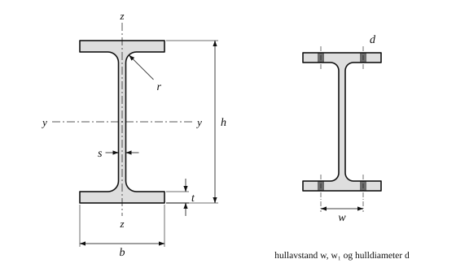

Dimensjoner etter NS-EN 10 034  
Materiale etter NS-EN 10 025  
Betegnelse f.eks.: Bjelke NS-EN 10 034 IPE 200, Stål NS-EN 10 025 …

| IPE | h mm | b mm | s mm | t mm | r mm | Masse kg/m | A 10³ mm² | Iy 10⁶ mm⁴ | Wy 10³ mm³ | iy mm | Iz 10⁶ mm⁴ | Wz 10³ mm³ | iz mm | IT 10³ mm⁴ | Sy 10³ mm³ | Cw 10⁹ mm⁶ | w mm | w1 mm | d mm |
| :-- | ------: | ------: | ------: | ------: | ------: | ------------: | -----------: | -----------------------: | -----------------------: | ------------------: | -----------------------: | -----------------------: | ------------------: | -----------------------: | -----------------------: | -----------------------: | ------: | ------------------: | ------: |
| 80  |      80 |      46 |     3.8 |     5.2 |       5 |          6.00 |        0.764 |                    0.801 |                     20.0 |                32.4 |                    0.085 |                     3.69 |                10.5 |                     7.00 |                     11.6 |                    0.118 |      26 |                   – |       – |
| 100 |     100 |      55 |     4.1 |     5.7 |       7 |          8.10 |         1.03 |                     1.71 |                     34.2 |                40.7 |                    0.159 |                     5.79 |                12.4 |                     12.1 |                     19.7 |                    0.351 |      30 |                   – |       – |
| 120 |     120 |      64 |     4.4 |     6.3 |       7 |          10.4 |         1.32 |                     3.18 |                     53.0 |                49.0 |                    0.277 |                     8.65 |                14.5 |                     17.4 |                     30.4 |                    0.890 |      36 |                   – |       – |
| 140 |     140 |      73 |     4.7 |     6.9 |       7 |          12.9 |         1.64 |                     5.41 |                     77.3 |                57.4 |                    0.449 |                     12.3 |                16.5 |                     24.5 |                     44.2 |                    1.981 |      40 |                   – |       – |
| 160 |     160 |      82 |     5.0 |     7.4 |       9 |          15.8 |         2.01 |                     8.69 |                      109 |                65.8 |                    0.683 |                     16.7 |                18.4 |                     36.2 |                     61.9 |                    3.959 |      44 |                   – |      13 |
| 180 |     180 |      91 |     5.3 |     8.0 |       9 |          18.8 |         2.39 |                    13.20 |                      146 |                74.2 |                     1.01 |                     22.2 |                20.5 |                     48.0 |                     83.2 |                    7.431 |      50 |                   – |      13 |
| 200 |     200 |     100 |     5.6 |     8.5 |      12 |          22.4 |         2.85 |                     19.4 |                      194 |                82.6 |                     1.42 |                     28.5 |                22.4 |                     70.2 |                      110 |                    12.99 |      56 |                   – |      13 |
| 220 |     220 |     110 |     5.9 |     9.2 |      12 |          26.2 |         3.34 |                     27.7 |                      252 |                91.1 |                     2.05 |                     37.3 |                24.8 |                     91.0 |                      143 |                    22.67 |      60 |                   – |      17 |
| 240 |     240 |     120 |     6.2 |     9.8 |      15 |          30.7 |         3.91 |                     38.9 |                      324 |                99.7 |                     2.84 |                     47.3 |                26.9 |                      129 |                      183 |                    37.39 |      68 |                   – |      17 |
| 270 |     270 |     135 |     6.6 |    10.2 |      15 |          36.1 |         4.59 |                     57.9 |                      429 |                 112 |                     4.20 |                     62.2 |                30.2 |                      160 |                      242 |                    70.58 |      72 |                   – |      17 |
| 300 |     300 |     150 |     7.1 |    10.7 |      15 |          42.2 |         5.38 |                     83.6 |                      557 |                 125 |                     6.04 |                     80.5 |                33.5 |                      202 |                      314 |                    125.9 |      80 |                   – |      23 |
| 330 |     330 |     160 |     7.5 |    11.5 |      18 |          49.1 |         6.26 |                    117.7 |                      713 |                 137 |                     7.88 |                     98.5 |                35.5 |                      283 |                      402 |                    199.1 |      86 |                   – |      25 |
| 360 |     360 |     170 |     8.0 |    12.7 |      18 |          57.1 |         7.27 |                    162.7 |                      904 |                 150 |                     10.4 |                      123 |                37.9 |                      375 |                      510 |                    313.6 |      90 |                   – |      25 |
| 400 |     400 |     180 |     8.6 |    13.5 |      21 |          66.3 |         8.45 |                    231.3 |                     1160 |                 165 |                     13.2 |                      146 |                39.5 |                      514 |                      654 |                    490.0 |      96 |                   – |      28 |
| 450 |     450 |     190 |     9.4 |    14.6 |      21 |          77.6 |         9.88 |                    337.4 |                     1500 |                 185 |                     16.8 |                      176 |                41.2 |                      671 |                      851 |                    791.0 |     106 |                   – |      28 |
| 500 |     500 |     200 |    10.2 |    16.0 |      21 |          90.7 |         11.6 |                    482.0 |                     1930 |                 204 |                     21.4 |                      214 |                43.1 |                      897 |                     1100 |                     1249 |     110 |                   – |      28 |
| 550 |     550 |     210 |    11.1 |    17.2 |      24 |           106 |         13.4 |                    671.2 |                     2440 |                 223 |                     26.7 |                      254 |                44.5 |                     1240 |                     1390 |                     1884 |     116 |                   – |      28 |
| 600 |     600 |     220 |    12.0 |    19.0 |      24 |           122 |         15.6 |                    920.8 |                     3070 |                 243 |                     33.9 |                      308 |                46.6 |                     1660 |                     1760 |                     2846 |     120 |                   – |      28 |

## Tabell 1.2 – Varmvalsede HE-A-bjelker

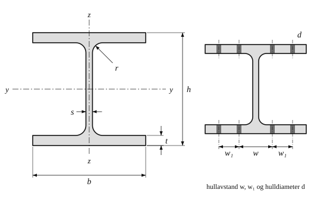

Dimensjoner etter NS-EN 10 034  
Materiale etter NS-EN 10 025  
Betegnelse f.eks.: Bjelke NS-EN 10 034 HE 360 A, Stål NS-EN 10 025 …

| HE-A | h mm | b mm | s mm | t mm | r mm | Masse kg/m | A 10³ mm² | Iy 10⁶ mm⁴ | Wy 10³ mm³ | iy mm | Iz 10⁶ mm⁴ | Wz 10³ mm³ | iz mm | IT 10³ mm⁴ | Sy 10³ mm³ | Cw 10⁹ mm⁶ | w mm | w1 mm | d mm |
| :--- | ------: | ------: | ------: | ------: | ------: | ------------: | -----------: | -----------------------: | -----------------------: | ------------------: | -----------------------: | -----------------------: | ------------------: | -----------------------: | -----------------------: | -----------------------: | ------: | ------------------: | ------: |
| 100  |      96 |     100 |       5 |       8 |      12 |          16.7 |         2.12 |                     3.49 |                     72.8 |                40.6 |                     1.34 |                     26.8 |                25.1 |                     52.6 |                     41.5 |                    2.581 |      56 |                   – |      13 |
| 120  |     114 |     120 |       5 |       8 |      12 |          19.9 |         2.53 |                     6.06 |                      106 |                48.9 |                     2.31 |                     38.5 |                30.2 |                     60.2 |                     59.7 |                    6.472 |      66 |                   – |      17 |
| 140  |     133 |     140 |     5.5 |     8.5 |      12 |          24.7 |         3.14 |                     10.3 |                      155 |                57.3 |                     3.89 |                     55.6 |                35.2 |                     81.6 |                     86.7 |                    15.06 |      76 |                   – |      21 |
| 160  |     152 |     160 |       6 |       9 |      15 |          30.4 |         3.88 |                     16.7 |                      220 |                65.7 |                     6.16 |                     76.9 |                39.8 |                      123 |                      123 |                    31.41 |      86 |                   – |      23 |
| 180  |     171 |     180 |       6 |     9.5 |      15 |          35.5 |         4.53 |                     25.1 |                      294 |                74.5 |                     9.25 |                      103 |                45.2 |                      149 |                      162 |                    60.21 |     100 |                   – |      25 |
| 200  |     190 |     200 |     6.5 |      10 |      18 |          42.3 |         5.38 |                     36.9 |                      389 |                82.8 |                     13.4 |                      134 |                49.8 |                      211 |                      215 |                    108.0 |     110 |                   – |      25 |
| 220  |     210 |     220 |       7 |      11 |      18 |          50.5 |         6.43 |                     54.1 |                      515 |                91.7 |                     19.5 |                      178 |                55.1 |                      286 |                      284 |                    193.3 |     120 |                   – |      25 |
| 240  |     230 |     240 |     7.5 |      12 |      21 |          60.3 |         7.68 |                     77.6 |                      675 |                 101 |                     27.7 |                      231 |                60.0 |                      417 |                      372 |                    328.5 |      94 |                  35 |      25 |
| 260  |     250 |     260 |     7.5 |    12.5 |      24 |          68.2 |         8.68 |                    104.5 |                      836 |                 110 |                     36.7 |                      282 |                65.0 |                      526 |                      460 |                    516.4 |     100 |                  40 |      25 |
| 280  |     270 |     280 |       8 |      13 |      24 |          76.4 |         9.73 |                    136.7 |                     1010 |                 119 |                     47.6 |                      340 |                70.0 |                      624 |                      556 |                    785.4 |     110 |                  45 |      25 |
| 300  |     290 |     300 |     8.5 |      14 |      27 |          88.3 |         11.2 |                    182.6 |                     1260 |                 127 |                     63.1 |                      421 |                74.9 |                      856 |                      692 |                     1200 |     120 |                  45 |      28 |
| 320  |     310 |     300 |       9 |    15.5 |      27 |          97.6 |         12.4 |                    229.3 |                     1480 |                 136 |                     69.9 |                      466 |                74.9 |                     1080 |                      814 |                     1512 |     120 |                  45 |      28 |
| 340  |     330 |     300 |     9.5 |    16.5 |      27 |           105 |         13.3 |                    276.9 |                     1680 |                 144 |                     74.4 |                      496 |                74.6 |                     1280 |                      925 |                     1824 |     120 |                  45 |      28 |
| 360  |     350 |     300 |      10 |    17.5 |      27 |           112 |         14.3 |                    330.9 |                     1890 |                 152 |                     78.9 |                      526 |                74.3 |                     1490 |                     1040 |                     2177 |     120 |                  45 |      28 |
| 400  |     390 |     300 |      11 |      19 |      27 |           125 |         15.9 |                    450.7 |                     2310 |                 168 |                     85.6 |                      571 |                73.4 |                     1900 |                     1280 |                     2942 |     120 |                  45 |      28 |
| 450  |     440 |     300 |    11.5 |      21 |      27 |           140 |         17.8 |                    637.2 |                     2900 |                 189 |                     94.7 |                      631 |                72.9 |                     2450 |                     1610 |                     4148 |     120 |                  45 |      28 |
| 500  |     490 |     300 |      12 |      23 |      27 |           155 |         19.8 |                    869.7 |                     3550 |                 210 |                    103.7 |                      691 |                72.4 |                     3100 |                     1970 |                     5643 |     120 |                  45 |      28 |
| 550  |     540 |     300 |    12.5 |      24 |      27 |           166 |         21.2 |                     1119 |                     4150 |                 230 |                    108.2 |                      721 |                71.5 |                     3530 |                     2310 |                     7189 |     120 |                  45 |      28 |
| 600  |     590 |     300 |      13 |      25 |      27 |           178 |         22.6 |                     1412 |                     4790 |                 250 |                    112.7 |                      751 |                70.5 |                     3990 |                     2680 |                     8978 |     120 |                  45 |      28 |
| 650  |     640 |     300 |    13.5 |      26 |      27 |           190 |         24.2 |                     1752 |                     5470 |                 269 |                    117.2 |                      782 |                69.7 |                     4500 |                     3070 |                    11027 |     120 |                  45 |      28 |
| 700  |     690 |     300 |    14.5 |      27 |      27 |           204 |         26.0 |                     2153 |                     6240 |                 288 |                    121.8 |                      812 |                68.4 |                     5150 |                     3520 |                    13352 |     120 |                  45 |      28 |
| 800  |     790 |     300 |      15 |      28 |      30 |           224 |         28.6 |                     3034 |                     7680 |                 326 |                    126.4 |                      843 |                66.5 |                     5990 |                     4350 |                    18290 |     130 |                  40 |      28 |
| 900  |     890 |     300 |      16 |      30 |      30 |           252 |         32.0 |                     4221 |                     9480 |                 363 |                    135.5 |                      903 |                65.0 |                     7390 |                     5410 |                    24962 |     130 |                  40 |      28 |
| 1000 |     990 |     300 |    16.5 |      31 |      30 |           272 |         34.7 |                     5538 |                    11190 |                 400 |                    140.0 |                      934 |                63.5 |                     8250 |                     6410 |                    32074 |     130 |                  40 |      28 |

## Tabell 1.3 – Varmvalsede HE-B-bjelker

Dimensjoner etter NS-EN 10 034  
Materiale etter NS-EN 10 025  
Betegnelse f.eks.: Bjelke NS-EN 10 034 HE 360 B, Stål NS-EN 10 025 …

| HE-B | h mm | b mm | s mm | t mm | r mm | Masse kg/m | A 10³ mm² | Iy 10⁶ mm⁴ | Wy 10³ mm³ | iy mm | Iz 10⁶ mm⁴ | Wz 10³ mm³ | iz mm | IT 10³ mm⁴ | Sy 10³ mm³ | Cw 10⁹ mm⁶ | w mm | w1 mm | d mm |
| :--- | ------: | ------: | ------: | ------: | ------: | ------------: | -----------: | -----------------------: | -----------------------: | ------------------: | -----------------------: | -----------------------: | ------------------: | -----------------------: | -----------------------: | -----------------------: | ------: | ------------------: | ------: |
| 100  |     100 |     100 |       6 |      10 |      12 |          20.4 |         2.60 |                     4.50 |                     89.9 |                41.6 |                     1.67 |                     33.5 |                25.3 |                     92.9 |                     52.1 |                    3.375 |      56 |                   – |      13 |
| 120  |     120 |     120 |     6.5 |      11 |      12 |          26.7 |         3.40 |                     8.64 |                      144 |                50.4 |                     3.18 |                     52.9 |                30.6 |                      139 |                     82.6 |                    9.410 |      66 |                   – |      17 |
| 140  |     140 |     140 |       7 |      12 |      12 |          33.7 |         4.30 |                     15.1 |                      216 |                59.3 |                     5.50 |                     78.5 |                35.8 |                      201 |                      123 |                    22.48 |      76 |                   – |      21 |
| 160  |     160 |     160 |       8 |      13 |      15 |          42.6 |         5.43 |                     24.9 |                      311 |                67.8 |                     8.89 |                      111 |                40.5 |                      314 |                      177 |                    47.94 |      86 |                   – |      23 |
| 180  |     180 |     180 |     8.5 |      14 |      15 |          51.2 |         6.53 |                     38.3 |                      426 |                76.6 |                     13.6 |                      151 |                45.7 |                      423 |                      241 |                    93.75 |     100 |                   – |      25 |
| 200  |     200 |     200 |       9 |      15 |      18 |          61.3 |         7.81 |                     57.0 |                      570 |                85.4 |                     20.0 |                      200 |                50.7 |                      595 |                      321 |                    171.1 |     110 |                   – |      25 |
| 220  |     220 |     220 |     9.5 |      16 |      18 |          71.5 |         9.10 |                     80.9 |                      736 |                94.3 |                     28.4 |                      258 |                55.9 |                      768 |                      414 |                    295.4 |     120 |                   – |      25 |
| 240  |     240 |     240 |      10 |      17 |      21 |          83.2 |         10.6 |                    112.6 |                      938 |                 103 |                     39.2 |                      327 |                60.8 |                     1030 |                      527 |                    486.9 |      96 |                  35 |      25 |
| 260  |     260 |     260 |      10 |    17.5 |      24 |          93.0 |         11.8 |                    149.2 |                     1150 |                 112 |                     51.3 |                      395 |                65.8 |                     1240 |                      641 |                    753.7 |     106 |                  40 |      25 |
| 280  |     280 |     280 |    10.5 |      18 |      24 |           103 |         13.1 |                    192.7 |                     1380 |                122  |                     65.9 |                      471 |                70.9 |                     1440 |                      767 |                     1130 |     110 |                  45 |      25 |
| 300  |     300 |     300 |      11 |      19 |      27 |           117 |         14.9 |                    251.7 |                     1680 |                 130 |                     85.6 |                      571 |                75.8 |                     1860 |                      934 |                     1688 |     120 |                  45 |      28 |
| 320  |     320 |     300 |    11.5 |    20.5 |      27 |           127 |         16.1 |                    308.2 |                     1930 |                 138 |                     92.4 |                      616 |                75.7 |                     2260 |                     1070 |                     2069 |     120 |                  45 |      28 |
| 340  |     340 |     300 |      12 |    21.5 |      27 |           134 |         17.1 |                    366.6 |                     2160 |                 146 |                     96.9 |                      646 |                75.3 |                     2580 |                     1200 |                     2454 |     120 |                  45 |      28 |
| 360  |     360 |     300 |    12.5 |    22.5 |      27 |           142 |         18.1 |                    431.9 |                     2400 |                 155 |                    101.4 |                      676 |                74.9 |                     2930 |                     1340 |                     2883 |     120 |                  45 |      28 |
| 400  |     400 |     300 |    13.5 |      24 |      27 |           155 |         19.8 |                    576.8 |                     2880 |                 171 |                    108.2 |                      721 |                74.0 |                     3570 |                     1620 |                     3817 |     120 |                  45 |      28 |
| 450  |     450 |     300 |      14 |      26 |      27 |           171 |         21.8 |                    798.9 |                     3550 |                 191 |                    117.2 |                      781 |                73.3 |                     4420 |                     1990 |                     5258 |     120 |                  45 |      28 |
| 500  |     500 |     300 |    14.5 |      28 |      27 |           187 |         23.9 |                     1072 |                     4290 |                 212 |                    126.2 |                      842 |                72.7 |                     5400 |                     2410 |                     7018 |     120 |                  45 |      28 |
| 550  |     550 |     300 |      15 |      29 |      27 |           199 |         25.4 |                     1367 |                     4970 |                 232 |                    130.8 |                      872 |                71.7 |                     6020 |                     2800 |                     8856 |     120 |                  45 |      28 |
| 600  |     600 |     300 |    15.5 |      30 |      27 |           212 |         27.0 |                     1710 |                     5700 |                 252 |                    135.3 |                      902 |                70.8 |                     6690 |                     3210 |                    10965 |     120 |                  45 |      28 |
| 650  |     650 |     300 |      16 |      31 |      27 |           225 |         28.6 |                     2106 |                     6480 |                 271 |                    139.8 |                      932 |                69.9 |                     7410 |                     3660 |                    13363 |     120 |                  45 |      28 |
| 700  |     700 |     300 |      17 |      32 |      27 |           241 |         30.6 |                     2569 |                     7340 |                 290 |                    144.4 |                      963 |                68.7 |                     8330 |                     4160 |                    16064 |     126 |                  45 |      28 |
| 800  |     800 |     300 |    17.5 |      33 |      30 |           262 |         33.4 |                     3591 |                     8980 |                 328 |                    149.0 |                      994 |                66.8 |                     9490 |                     5110 |                    21840 |     130 |                  40 |      28 |
| 900  |     900 |     300 |    18.5 |      35 |      30 |           291 |         37.1 |                     4941 |                    10980 |                 365 |                    158.2 |                     1050 |                65.3 |                    11400 |                     6290 |                    29461 |     130 |                  40 |      28 |
| 1000 |    1000 |     300 |      19 |      36 |      30 |           314 |         40.0 |                     6447 |                    12890 |                 401 |                    162.8 |                     1090 |                63.8 |                    12600 |                     7430 |                    37637 |     130 |                  40 |      28 |

## Tabell 1.4 – Varmformede kvadratiske hulprofil

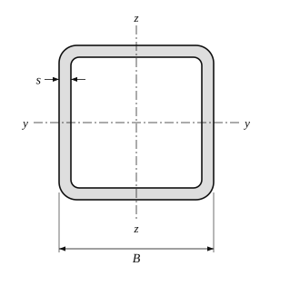

Dimensjoner etter NS-EN 10 210-2  
Materiale etter NS-EN 10 210-1  
Betegnelse f.eks.: HFRHS-NS-EN 10 210 S 355 JOH 80 x 80 x 4

| B mm | s mm | Masse kg/m | A 10³ mm² | I 10⁶ mm⁴ | W 10³ mm³ | i mm | Wp 10³ mm³ | IT 10⁶ mm⁴ |
| :------ | ------: | ------------: | -----------: | -----------: | -----------: | ------: | -----------------------: | -----------------------: |
| 40      |     2.6 |          3.03 |        0.386 |       0.0894 |         4.47 |    15.2 |                     5.39 |                    0.140 |
| 40      |     3.2 |          3.66 |        0.466 |        0.104 |         5.22 |    15.0 |                     6.40 |                    0.165 |
| 40      |     4.0 |          4.46 |        0.568 |        0.121 |         6.07 |    14.6 |                     7.61 |                    0.195 |
| 50      |     3.2 |          4.66 |        0.594 |        0.216 |         8.62 |    19.1 |                     10.4 |                    0.338 |
| 50      |     4.0 |          5.72 |        0.728 |        0.255 |         10.2 |    18.7 |                     12.5 |                    0.404 |
| 50      |     5.0 |          6.97 |        0.888 |        0.296 |         11.9 |    18.3 |                     14.9 |                    0.476 |
| 60      |     3.2 |          5.67 |        0.722 |        0.387 |         12.9 |    23.1 |                     15.3 |                    0.601 |
| 60      |     4.0 |          6.97 |        0.888 |        0.461 |         15.4 |    22.8 |                     18.6 |                    0.724 |
| 60      |     5.0 |          8.54 |         1.09 |        0.544 |         18.1 |    22.4 |                     22.3 |                    0.863 |
| 80      |     3.6 |          8.59 |         1.09 |         1.06 |         26.5 |    31.1 |                     31.3 |                     1.64 |
| 80      |     4.0 |          9.48 |         1.21 |         1.16 |         29.0 |    31.0 |                     34.3 |                     1.80 |
| 80      |     5.0 |          11.7 |         1.49 |         1.39 |         34.7 |    30.5 |                     41.7 |                     2.17 |
| 80      |     6.3 |          14.4 |         1.84 |         1.65 |         41.3 |    30.0 |                     50.5 |                     2.61 |
| 100     |     4.0 |          12.0 |         1.53 |         2.34 |         46.8 |    39.1 |                     54.9 |                     3.61 |
| 100     |     5.0 |          14.8 |         1.89 |         2.83 |         56.6 |    38.7 |                     67.1 |                     4.39 |
| 100     |     6.3 |          18.4 |         2.34 |         3.41 |         68.2 |    38.1 |                     82.0 |                     5.33 |
| 100     |     8.0 |          22.9 |         2.91 |         4.08 |         81.5 |    37.4 |                     99.9 |                     6.46 |
| 100     |    10.0 |          27.9 |         3.55 |         4.74 |         94.9 |    36.5 |                      119 |                     7.61 |
| 120     |     5.0 |          18.0 |         2.29 |         5.03 |         83.8 |    46.9 |                     98.4 |                     7.75 |
| 120     |     6.3 |          22.3 |         2.85 |         6.10 |          102 |    46.3 |                      121 |                     9.49 |
| 120     |     8.0 |          27.9 |         3.55 |         7.38 |          123 |    45.6 |                      149 |                     11.6 |
| 120     |    10.0 |          34.2 |         4.35 |         8.70 |          145 |    44.7 |                      178 |                     13.8 |
| 140     |     5.0 |          20.9 |         2.66 |         8.01 |          114 |    54.9 |                      134 |                     12.5 |
| 140     |     6.3 |          26.0 |         3.31 |         9.74 |          139 |    54.2 |                      165 |                     15.5 |
| 140     |     8.0 |          32.4 |         4.13 |         11.8 |          168 |    53.4 |                      202 |                     19.0 |
| 150     |       5 |          22.5 |         2.86 |         9.94 |          133 |    58.9 |                      155 |                     15.6 |
| 150     |     6.3 |          28.0 |         3.56 |         12.1 |          162 |    58.3 |                      191 |                     19.2 |
| 150     |       8 |          34.9 |         4.45 |         14.7 |          196 |    57.5 |                      234 |                     23.6 |
| 160     |     6.3 |          29.9 |         3.80 |         14.9 |          186 |    62.4 |                      218 |                     23.4 |
| 160     |     8.0 |          37.4 |         4.77 |         18.1 |          226 |    61.6 |                      269 |                     28.9 |
| 160     |    10.0 |          45.7 |         5.85 |         21.5 |          269 |    60.6 |                      325 |                     34.9 |
| 180     |     6.3 |          33.9 |         4.32 |         21.5 |          239 |    70.6 |                      280 |                     33.8 |
| 180     |     8.0 |          42.5 |         5.41 |         26.3 |          293 |    69.8 |                      346 |                     41.8 |
| 180     |    10.0 |          52.2 |         6.65 |         31.5 |          350 |    68.8 |                      419 |                     50.7 |
| 200     |     6.3 |          37.8 |         4.82 |         29.9 |          299 |    78.8 |                      348 |                     46.7 |
| 200     |     8.0 |          47.5 |         6.05 |         36.8 |          368 |    78.0 |                      432 |                     58.1 |
| 200     |    10.0 |          58.5 |         7.45 |         44.2 |          442 |    77.0 |                      526 |                     70.6 |
| 250     |     6.3 |          47.7 |         6.08 |         59.8 |          479 |    99.2 |                      554 |                     92.7 |
| 250     |     8.0 |          60.0 |         7.65 |         74.0 |          592 |    98.4 |                      690 |                      116 |
| 250     |    10.0 |          74.2 |         9.45 |         89.7 |          718 |    97.4 |                      845 |                      142 |
| 300     |    10.0 |          89.9 |         11.4 |          159 |         1061 |     118 |                     1238 |                      249 |

Merk: Dimensjonene for kaldformede hulprofil avviker fra dimensjonene gitt i denne tabellen.

## Tabell 1.5 – Varmformede rektangulære hulprofil

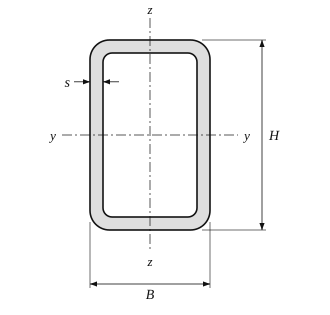

Dimensjoner etter NS-EN 10 210-2  
Materiale etter NS-EN 10 210-1  
Betegnelse f.eks.: HFRHS-NS-EN 10 210 120 x 80 x 5

| H x B mm x mm | s mm | Masse kg/m | A 10³ mm² | Iy 10⁶ mm⁴ | Wy 10³ mm³ | iy mm | Wp,y 10³ mm³ | Iz 10⁶ mm⁴ | Wz 10³ mm³ | iz mm | Wp,z 10³ mm³ | IT 10⁶ mm⁴ |
| :--------------- | ------: | ------------: | -----------: | -----------------------: | -----------------------: | ------------------: | -------------------------: | -----------------------: | -----------------------: | ------------------: | -------------------------: | -----------------------: |
| 50x30            |     2.6 |          3.03 |        0.386 |                    0.124 |                     4.96 |                17.9 |                       6.21 |                   0.0545 |                     3.63 |                11.9 |                       4.30 |                    0.121 |
| 50x30            |     3.2 |          3.66 |        0.466 |                    0.145 |                     5.82 |                17.7 |                       7.39 |                   0.0631 |                     4.21 |                11.6 |                       5.08 |                    0.142 |
| 50x30            |     4.0 |          4.46 |        0.568 |                    0.170 |                     6.80 |                17.3 |                       8.81 |                   0.0725 |                     4.83 |                11.3 |                       6.01 |                    0.166 |
| 60x40            |     3.2 |          4.66 |        0.594 |                    0.283 |                     9.44 |                21.8 |                       11.7 |                    0.148 |                     7.39 |                15.8 |                       8.75 |                    0.306 |
| 60x40            |     4.0 |          5.72 |        0.728 |                    0.336 |                     11.2 |                21.5 |                       14.1 |                    0.173 |                     8.67 |                15.4 |                       10.5 |                    0.366 |
| 80x40            |     3.2 |          5.67 |        0.722 |                    0.581 |                     14.5 |                28.4 |                       18.3 |                    0.191 |                     9.56 |                16.3 |                       11.1 |                    0.461 |
| 80x40            |     4.0 |          6.97 |        0.888 |                    0.696 |                     17.4 |                28.0 |                       22.2 |                    0.226 |                     11.3 |                15.9 |                       13.4 |                    0.551 |
| 80x40            |     5.0 |          8.54 |         1.09 |                    0.824 |                     20.6 |                27.5 |                       26.7 |                    0.262 |                     13.1 |                15.5 |                       15.9 |                    0.650 |
| 100x50           |     3.2 |          7.18 |        0.914 |                     1.17 |                     23.5 |                35.8 |                       29.2 |                    0.391 |                     15.6 |                20.7 |                       17.9 |                    0.933 |
| 100x50           |     4.0 |          8.86 |         1.13 |                     1.42 |                     28.4 |                35.5 |                       35.7 |                    0.467 |                     18.7 |                20.3 |                       21.7 |                     1.13 |
| 100x50           |     5.0 |          10.9 |         1.39 |                     1.70 |                     34.0 |                35.0 |                       43.3 |                    0.551 |                     22.0 |                19.9 |                       26.1 |                     1.35 |
| 120x60           |     3.6 |          9.73 |         1.24 |                     2.30 |                     38.3 |                43.1 |                       47.6 |                    0.769 |                     25.6 |                24.9 |                       29.2 |                     1.83 |
| 120x60           |     5.0 |          13.3 |         1.69 |                     3.04 |                     50.7 |                42.4 |                       63.9 |                    0.999 |                     33.3 |                24.3 |                       38.8 |                     2.42 |
| 120x60           |     6.3 |          16.4 |         2.09 |                     3.66 |                     61.0 |                41.8 |                       78.0 |                     1.18 |                     39.4 |                23.8 |                       46.9 |                     2.90 |
| 120x80           |     5.0 |          14.8 |         1.89 |                     3.70 |                     61.7 |                44.3 |                       75.4 |                     1.95 |                     48.8 |                32.1 |                       56.7 |                     4.01 |
| 120x80           |     6.3 |          18.4 |         2.34 |                     4.47 |                     74.6 |                43.7 |                       92.3 |                     2.34 |                     58.4 |                31.6 |                       69.1 |                     4.86 |
| 120x80           |     8.0 |          22.9 |         2.91 |                     5.37 |                     89.5 |                42.9 |                        113 |                     2.78 |                     69.4 |                30.9 |                       83.9 |                     5.86 |
| 140x80           |     5.0 |          16.4 |         2.09 |                     5.41 |                     77.2 |                50.9 |                       95.3 |                     2.23 |                     55.8 |                32.7 |                       64.2 |                     4.99 |
| 140x80           |     6.3 |          20.4 |         2.59 |                     6.56 |                     93.8 |                50.3 |                        117 |                     2.68 |                     67.0 |                32.1 |                       78.4 |                     6.06 |
| 140x80           |     8.0 |          25.4 |         3.23 |                     7.93 |                      113 |                49.5 |                        143 |                     3.19 |                     79.8 |                31.4 |                       95.4 |                     7.32 |
| 150x100          |     5.0 |          18.7 |         2.39 |                     7.47 |                     99.5 |                55.9 |                        121 |                     3.96 |                     79.1 |                40.7 |                       90.8 |                     8.06 |
| 150x100          |     6.3 |          23.3 |         2.97 |                     9.10 |                      121 |                55.3 |                        148 |                     4.79 |                     95.9 |                40.2 |                        111 |                     9.85 |
| 150x100          |     8.0 |          29.1 |         3.71 |                     11.1 |                      147 |                54.6 |                        183 |                     5.77 |                      115 |                39.4 |                        137 |                     12.0 |
| 160x80           |     5.0 |          18.0 |         2.29 |                     7.53 |                     94.1 |                57.4 |                        117 |                     2.51 |                     62.8 |                33.1 |                       71.7 |                     5.99 |
| 160x80           |     6.3 |          22.3 |         2.85 |                     9.17 |                      115 |                56.8 |                        144 |                     3.02 |                     75.6 |                32.6 |                       87.7 |                     7.29 |
| 160x80           |     8.0 |          27.9 |         3.55 |                     11.1 |                      139 |                56.0 |                        177 |                     3.61 |                     90.2 |                31.9 |                        107 |                     8.82 |
| 160x80           |    10.0 |          34.2 |         4.35 |                     13.2 |                      165 |                55.0 |                        213 |                     4.19 |                      105 |                31.0 |                        127 |                     10.4 |
| 200x100          |     5.0 |          22.5 |         2.86 |                     14.8 |                      148 |                72.0 |                        184 |                     5.02 |                      100 |                41.9 |                        113 |                     12.1 |
| 200x100          |     6.3 |          28.0 |         3.56 |                     18.1 |                      181 |                71.3 |                        226 |                     6.07 |                      121 |                41.3 |                        139 |                     14.8 |
| 200x100          |     8.0 |          34.9 |         4.45 |                     22.0 |                      220 |                70.3 |                        279 |                     7.29 |                      146 |                40.5 |                        170 |                     18.1 |
| 200x100          |    10.0 |          42.8 |         5.45 |                     26.1 |                      261 |                69.2 |                        336 |                     8.53 |                      171 |                39.6 |                        203 |                     21.6 |
| 200x120          |     6.3 |          29.9 |         3.81 |                     20.5 |                      205 |                73.2 |                        251 |                     9.21 |                      154 |                49.1 |                        176 |                     20.4 |
| 200x120          |       8 |          37.4 |         4.77 |                     25.0 |                      250 |                72.3 |                        310 |                     11.2 |                      186 |                48.4 |                        216 |                     25.0 |
| 200x120          |      10 |          45.9 |         5.85 |                     29.7 |                      297 |                71.3 |                        374 |                     13.2 |                      219 |                47.4 |                        260 |                     30.1 |
| 250x150          |     6.3 |          37.8 |         4.82 |                     41.1 |                      329 |                92.4 |                        400 |                     18.6 |                      248 |                62.2 |                        281 |                     40.7 |
| 250x150          |     8.0 |          47.5 |         6.05 |                     50.6 |                      405 |                91.5 |                        497 |                     22.8 |                      304 |                61.4 |                        348 |                     50.4 |
| 250x150          |    10.0 |          58.5 |         7.45 |                     60.9 |                      487 |                90.4 |                        605 |                     27.2 |                      363 |                60.5 |                        422 |                     61.1 |
| 300x200          |     6.3 |          47.7 |         6.08 |                     77.9 |                      519 |                 113 |                        621 |                     41.7 |                      417 |                82.8 |                        470 |                     85.1 |
| 300x200          |     8.0 |          60.0 |         7.65 |                     96.5 |                      643 |                 112 |                        775 |                     51.5 |                      515 |                82.1 |                        586 |                      106 |
| 300x200          |    10.0 |          74.2 |         9.45 |                      117 |                      780 |                 111 |                        948 |                     62.2 |                      622 |                81.2 |                        716 |                      130 |

Merk: Dimensjonene for kaldformede hulprofil avviker fra dimensjonene gitt i denne tabellen.

## Tabell 1.6 – Halve IPE-bjelker

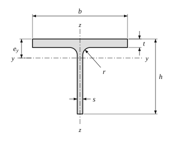

Ved store leveranser kan disse leveres ferdig delt fra verk.  
Ved deling med skjærebrenner kan det være nødvendig å rette bjelkene etter delingen.

| ½ IPE | h mm | b mm | s mm | t mm | r mm | Masse kg/m | A 10³ mm² | Iy 10⁶ mm⁴ | Wy 10³ mm³ | iy mm | Iz 10⁶ mm⁴ | Wz 10³ mm³ | iz mm | IT 10³ mm⁴ | ey mm |
| :---- | ------: | ------: | ------: | ------: | ------: | ------------: | -----------: | -----------------------: | -----------------------: | ------------------: | -----------------------: | -----------------------: | ------------------: | -----------------------: | ------------------: |
| 80    |      40 |      46 |     3.8 |     5.2 |       5 |          3.00 |        0.382 |                   0.0481 |                     1.58 |                11.2 |                   0.0425 |                     1.85 |                10.5 |                      3.5 |                9.63 |
| 100   |      50 |      55 |     4.1 |     5.7 |       7 |          4.05 |        0.515 |                    0.103 |                     2.70 |                14.1 |                   0.0795 |                     2.90 |                12.4 |                      6.0 |                11.9 |
| 120   |      60 |      64 |     4.4 |     6.3 |       7 |          5.20 |        0.660 |                    0.193 |                     4.20 |                17.1 |                    0.139 |                     4.33 |                14.5 |                      8.7 |                14.0 |
| 140   |      70 |      73 |     4.7 |     6.9 |       7 |          6.45 |        0.820 |                    0.332 |                     6.17 |                20.1 |                    0.225 |                     6.15 |                16.5 |                     12.2 |                16.2 |
| 160   |      80 |      82 |     5.0 |     7.4 |       9 |          7.90 |         1.01 |                    0.529 |                     8.57 |                22.9 |                    0.342 |                     8.35 |                18.4 |                     18.1 |                18.3 |
| 180   |      90 |      91 |     5.3 |     8.0 |       9 |          9.40 |         1.20 |                    0.802 |                     11.6 |                25.9 |                    0.505 |                     11.1 |                20.5 |                     24.0 |                20.5 |
| 200   |     100 |     100 |     5.6 |     8.5 |      12 |          11.2 |         1.43 |                     1.17 |                     15.1 |                28.6 |                    0.710 |                     14.3 |                22.4 |                     35.1 |                22.4 |
| 220   |     110 |     110 |     5.9 |     9.2 |      12 |          13.1 |         1.67 |                     1.65 |                     19.3 |                31.4 |                     1.03 |                     18.7 |                24.8 |                     45.0 |                24.5 |
| 240   |     120 |     120 |     6.2 |     9.8 |      15 |          15.4 |         1.96 |                     2.27 |                     24.2 |                34.0 |                     1.42 |                     23.7 |                26.9 |                     64.5 |                26.2 |
| 270   |     135 |     135 |     6.6 |    10.2 |      15 |          18.1 |         2.30 |                     3.45 |                     32.8 |                38.7 |                     2.10 |                     31.1 |                30.2 |                     80.0 |                29.7 |
| 300   |     150 |     150 |     7.1 |    10.7 |      15 |          21.1 |         2.69 |                     5.09 |                     43.6 |                43.5 |                     3.02 |                     40.3 |                33.5 |                      101 |                33.2 |
| 330   |     165 |     160 |     7.5 |    11.5 |      18 |          24.6 |         3.13 |                     7.17 |                     55.8 |                47.9 |                     3.94 |                     49.3 |                35.5 |                      141 |                36.5 |
| 360   |     180 |     170 |     8.0 |    12.7 |      18 |          28.6 |         3.64 |                     9.93 |                     70.8 |                52.2 |                     5.20 |                     61.5 |                37.9 |                      187 |                39.8 |
| 400   |     200 |     180 |     8.6 |    13.5 |      21 |          33.2 |         4.23 |                     14.5 |                     93.7 |                58.5 |                     6.60 |                       73 |                39.5 |                      257 |                45.2 |
| 450   |     225 |     190 |     9.4 |    14.6 |      21 |          38.8 |         4.94 |                     22.2 |                      129 |                67.0 |                     8.40 |                       88 |                41.2 |                      335 |                52.8 |
| 500   |     250 |     200 |    10.2 |    16.0 |      21 |          45.4 |         5.80 |                     32.6 |                      172 |                74.7 |                    10.70 |                      107 |                43.1 |                      448 |                59.8 |
| 550   |     275 |     210 |    11.1 |    17.2 |      24 |          52.8 |         6.72 |                     46.7 |                      225 |                83.3 |                    13.35 |                      127 |                44.5 |                      620 |                67.8 |
| 600   |     300 |     220 |    12.0 |    19.0 |      24 |          61.2 |         7.80 |                     65.0 |                      288 |                91.3 |                    16.95 |                      154 |                46.6 |                      830 |                74.8 |

## Tabell 1.7 – Halve HE-A-bjelker

Ved store leveranser kan disse leveres ferdig delt fra verk.  
Ved deling med skjærebrenner kan det være nødvendig å rette bjelkene etter delingen.

| ½ HE-A | h mm | b mm | s mm | t mm | r mm | Masse kg/m | A 10³ mm² | Iy 10⁶ mm⁴ | Wy 10³ mm³ | iy mm | Iz 10⁶ mm⁴ | Wz 10³ mm³ | iz mm | IT 10³ mm⁴ | ey mm |
| :----- | ------: | ------: | ------: | ------: | ------: | ------------: | -----------: | -----------------------: | -----------------------: | ------------------: | -----------------------: | -----------------------: | ------------------: | -----------------------: | ------------------: |
| 100    |      48 |     100 |       5 |       8 |      12 |           8.3 |         1.06 |                     0.12 |                     3.07 |                10.8 |                     0.67 |                     13.4 |                25.1 |                     26.3 |                 8.9 |
| 120    |      57 |     120 |       5 |       8 |      12 |           9.9 |         1.27 |                     0.21 |                     4.45 |                13.0 |                     1.15 |                     19.2 |                30.2 |                     30.1 |                 9.8 |
| 140    |      66 |     140 |     5.5 |     8.5 |      12 |          12.3 |         1.57 |                     0.37 |                     6.70 |                15.3 |                     1.95 |                     27.8 |                35.3 |                     40.8 |                11.2 |
| 160    |      76 |     160 |       6 |       9 |      15 |          15.2 |         1.94 |                     0.61 |                     9.65 |                17.8 |                     3.08 |                     38.5 |                39.8 |                     61.5 |                12.8 |
| 180    |      85 |     180 |       6 |     9.5 |      15 |          17.8 |         2.27 |                     0.89 |                     12.4 |                19.8 |                     4.62 |                     51.4 |                45.2 |                     74.5 |                13.7 |
| 200    |      95 |     200 |     6.5 |      10 |      18 |          21.1 |         2.69 |                     1.33 |                     16.7 |                22.2 |                     6.68 |                     66.8 |                49.8 |                      105 |                15.2 |
| 220    |     105 |     220 |       7 |      11 |      18 |          25.3 |         3.22 |                     1.94 |                     22.0 |                24.5 |                     9.77 |                     88.8 |                55.1 |                      143 |                16.6 |
| 240    |     115 |     240 |     7.5 |      12 |      21 |          30.2 |         3.84 |                     2.73 |                     28.2 |                26.7 |                    13.84 |                      115 |                60.0 |                      208 |                18.1 |
| 260    |     125 |     260 |     7.5 |    12.5 |      24 |          34.1 |         4.34 |                     3.55 |                     33.7 |                28.6 |                    18.34 |                      141 |                65.0 |                      263 |                19.1 |
| 280    |     135 |     280 |       8 |      13 |      24 |          38.2 |         4.87 |                     4.77 |                     41.7 |                31.3 |                    23.81 |                      170 |                70.0 |                      312 |                20.6 |
| 300    |     145 |     300 |     8.5 |      14 |      27 |          44.2 |         5.63 |                     6.30 |                     51.2 |                33.5 |                    31.55 |                      210 |                74.9 |                      428 |                22.0 |
| 320    |     155 |     300 |       9 |    15.5 |      27 |          48.8 |         6.22 |                     8.08 |                     61.7 |                36.0 |                    34.93 |                      232 |                74.9 |                      540 |                24.1 |
| 340    |     165 |     300 |     9.5 |    16.5 |      27 |          52.4 |         6.68 |                    10.19 |                     73.7 |                39.1 |                    37.18 |                      248 |                74.6 |                      640 |                26.4 |
| 360    |     175 |     300 |      10 |    17.5 |      27 |          56.0 |         7.14 |                    12.68 |                     86.5 |                42.2 |                    39.43 |                      263 |                74.3 |                      745 |                28.7 |
| 400    |     195 |     300 |      11 |      19 |      27 |          62.4 |         7.95 |                    18.94 |                      118 |                48.8 |                    42.82 |                      285 |                73.4 |                      950 |                33.9 |
| 450    |     220 |     300 |    11.5 |      21 |      27 |          69.9 |         8.90 |                    28.15 |                      156 |                56.2 |                    47.33 |                      315 |                72.9 |                     1220 |                39.4 |
| 500    |     245 |     300 |      12 |      23 |      27 |          77.5 |         9.88 |                    40.18 |                      201 |                63.8 |                    51.84 |                      345 |                72.4 |                     1550 |                45.1 |
| 550    |     270 |     300 |    12.5 |      24 |      27 |          83.1 |         10.6 |                    55.28 |                      253 |                72.3 |                    54.10 |                      361 |                71.5 |                     1760 |                51.7 |
| 600    |     295 |     300 |      13 |      25 |      27 |          88.9 |         11.3 |                    73.99 |                      313 |                80.8 |                    56.36 |                      376 |                70.5 |                     1990 |                58.7 |
| 650    |     320 |     300 |    13.5 |      26 |      27 |          94.8 |         12.1 |                    96.75 |                      381 |                89.5 |                    58.62 |                      391 |                69.7 |                     2250 |                66.1 |
| 700    |     345 |     300 |    14.5 |      27 |      27 |           102 |         13.0 |                    127.4 |                      472 |                98.9 |                    60.89 |                      406 |                68.4 |                     2570 |                75.0 |
| 800    |     395 |     300 |      15 |      28 |      30 |           112 |         14.3 |                    193.3 |                      635 |                 116 |                    63.19 |                      421 |                66.5 |                     2990 |                90.6 |
| 900    |     445 |     300 |      16 |      30 |      30 |           126 |         16.0 |                    287.1 |                      851 |                 134 |                    67.74 |                      452 |                65.0 |                     3690 |               108.0 |
| 1000   |     495 |     300 |    16.5 |      31 |      30 |           136 |         17.3 |                    398.4 |                     1078 |                 152 |                    70.02 |                      467 |                63.5 |                     4120 |               125.0 |

## Tabell 1.8 – Varmvalsede rundkantede kanalprofil

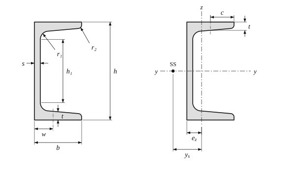

Dimensjoner etter NS 1911. Toleranser etter NS-EN 10 279  
Materiale etter NS-EN 10 025  
Betegnelse f.eks.: Kanalstål NS 1911 U 300, Stål NS-EN 10 025

| U   | h mm | b mm | s mm | t = r1 mm | r2 mm | h1 mm | Masse kg/m | A 10³ mm² | Iy 10⁶ mm⁴ | Wy 10³ mm³ | iy mm | Iz 10⁶ mm⁴ | Wz 10³ mm³ | iz mm | IT 10³ mm⁴ | Sy 10³ mm³ | Cw 10⁹ mm⁶ | ez mm | ys mm | w mm | d mm |
| :-- | ------: | ------: | ------: | ----------------------: | ------------------: | ------------------: | ------------: | -----------: | -----------------------: | -----------------------: | ------------------: | -----------------------: | -----------------------: | ------------------: | -----------------------: | -----------------------: | -----------------------: | ------------------: | ------------------: | ------: | ------: |
| 30  |      30 |      33 |       5 |                       7 |                 3.5 |                   1 |          4.27 |        0.544 |                   0.0639 |                     4.26 |                10.8 |                   0.0533 |                     2.68 |                 9.9 |                     9.12 |                     2.53 |                  0.00436 |                13.1 |                22.2 |      20 |       – |
| 40  |      40 |      35 |       5 |                       7 |                 3.5 |                  11 |          4.87 |        0.621 |                    0.141 |                     7.05 |                15.0 |                   0.0668 |                     3.08 |                10.4 |                     10.0 |                     4.20 |                   0.0119 |                13.3 |                23.2 |      20 |       – |
| 50  |      50 |      38 |       5 |                       7 |                 3.5 |                  20 |          5.59 |        0.712 |                    0.264 |                     10.6 |                19.2 |                   0.0912 |                     3.75 |                11.3 |                     11.2 |                     6.30 |                   0.0278 |                13.7 |                24.7 |      20 |       – |
| 60  |      60 |      30 |       6 |                       6 |                   3 |                  29 |          5.07 |        0.646 |                    0.316 |                     10.5 |                22.1 |                   0.0451 |                     2.16 |                 8.4 |                     9.39 |                     6.25 |                   0.0219 |                 9.1 |                15.0 |      18 |       – |
| 65  |      65 |      42 |     5.5 |                     7.5 |                   4 |                  33 |          7.09 |        0.903 |                    0.575 |                     17.7 |                25.2 |                    0.141 |                     5.07 |                12.5 |                     16.1 |                     10.5 |                   0.0773 |                14.2 |                26.0 |      25 |       – |
| 80  |      80 |      45 |       6 |                       8 |                   4 |                  46 |          8.64 |         1.10 |                     1.06 |                     26.5 |                31.0 |                    0.194 |                     6.36 |                13.3 |                     21.6 |                     15.9 |                    0.168 |                14.5 |                26.7 |      25 |      13 |
| 100 |     100 |      50 |       6 |                     8.5 |                 4.5 |                  64 |          10.6 |         1.35 |                     2.06 |                     41.2 |                39.1 |                    0.293 |                     8.49 |                14.7 |                     28.1 |                     24.5 |                    0.414 |                15.5 |                29.3 |      30 |      13 |
| 120 |     120 |      55 |       7 |                       9 |                 4.5 |                  82 |          13.4 |         1.70 |                     3.64 |                     60.7 |                46.2 |                    0.432 |                     11.1 |                15.9 |                     41.5 |                     36.3 |                    0.900 |                16.0 |                30.3 |      30 |      17 |
| 140 |     140 |      60 |       7 |                      10 |                   5 |                  98 |          16.0 |         2.04 |                     6.05 |                     86.4 |                54.5 |                    0.627 |                     14.8 |                17.5 |                     56.8 |                     51.4 |                     1.80 |                17.5 |                33.7 |      35 |      17 |
| 160 |     160 |      65 |     7.5 |                    10.5 |                 5.5 |                 115 |          18.8 |         2.40 |                     9.25 |                      116 |                62.1 |                    0.853 |                     18.3 |                18.9 |                     73.9 |                     68.8 |                     3.26 |                18.4 |                35.6 |      35 |      21 |
| 180 |     180 |      70 |       8 |                      11 |                 5.5 |                 133 |          22.0 |         2.80 |                     13.5 |                      150 |                69.5 |                     1.14 |                     22.4 |                20.2 |                     95.5 |                     89.6 |                     5.57 |                19.2 |                37.5 |      40 |      21 |
| 200 |     200 |      75 |     8.5 |                    11.5 |                   6 |                 151 |          25.3 |         3.22 |                     19.1 |                      191 |                77.0 |                     1.48 |                     27.0 |                21.4 |                      119 |                      114 |                     9.07 |                20.1 |                39.4 |      40 |      23 |
| 220 |     220 |      80 |       9 |                    12.5 |                 6.5 |                 167 |          29.4 |         3.74 |                     26.9 |                      245 |                84.8 |                     1.97 |                     33.6 |                23.0 |                      160 |                      146 |                     14.6 |                21.4 |                42.0 |      45 |      23 |
| 240 |     240 |      85 |     9.5 |                      13 |                 6.5 |                 184 |          33.2 |         4.23 |                     36.0 |                      300 |                92.2 |                     2.48 |                     39.6 |                24.2 |                      197 |                      179 |                     22.1 |                22.3 |                43.9 |      45 |      25 |
| 260 |     260 |      90 |      10 |                      14 |                   7 |                 200 |          37.9 |         4.83 |                     48.2 |                      371 |                99.9 |                     3.17 |                     47.7 |                25.6 |                      255 |                      221 |                     33.3 |                23.6 |                46.6 |      50 |      25 |
| 280 |     280 |      95 |      10 |                      15 |                 7.5 |                 216 |          41.8 |         5.33 |                     62.8 |                      448 |                 109 |                     3.99 |                     57.2 |                27.4 |                      310 |                      266 |                     48.5 |                25.3 |                50.2 |      50 |      25 |
| 300 |     300 |     100 |      10 |                      16 |                   8 |                 232 |          46.2 |         5.88 |                     80.3 |                      535 |                 117 |                     4.95 |                     67.8 |                29.0 |                      374 |                      316 |                     69.1 |                27.0 |                54.1 |      55 |      28 |
| 320 |     320 |     100 |      14 |                    17.5 |                8.75 |                 246 |          59.5 |         7.58 |                      109 |                      679 |                 121 |                     5.97 |                     80.6 |                28.1 |                      667 |                      413 |                     96.1 |                26.0 |                48.2 |      57 |      28 |
| 350 |     350 |     100 |      14 |                      16 |                   8 |                 282 |          60.6 |         7.73 |                      128 |                      734 |                 129 |                     5.70 |                     75.0 |                27.2 |                      612 |                      459 |                      114 |                24.0 |                44.5 |      57 |      28 |
| 380 |     380 |     102 |    13.5 |                      16 |                   8 |                 312 |          63.1 |         8.04 |                      158 |                      829 |                 140 |                     6.15 |                     78.7 |                27.7 |                      591 |                      507 |                      146 |                23.8 |                45.8 |      60 |      28 |
| 400 |     400 |     110 |      14 |                      18 |                   9 |                 324 |          71.8 |         9.15 |                      204 |                     1020 |                 149 |                     8.46 |                      102 |                30.4 |                      816 |                      618 |                      221 |                26.5 |                51.1 |      60 |      28 |

Avstand fra flenstupp til snitt hvor flenstykkelse t er angitt: c = b/2 for h ≤ 300 mm, c = (b − s)/2 for h > 300 mm.

## Tabell 1.9 – Varmvalsede kanalprofil med parallelle flenser

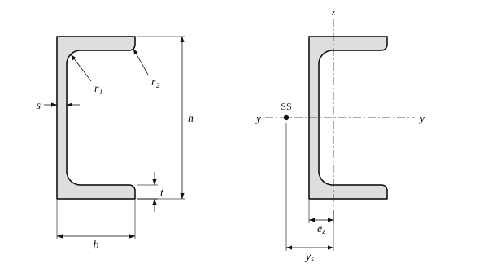

Dimensjoner etter svensk standard SS 21 27 30  
Materiale etter NS-EN 10 025  
Toleranser etter NS-EN 10 279  
Betegnelse f.eks.: Kanalstål SS 21 27 30 USP 100, Stål …

| USP | h mm | b mm | s mm | t mm | r1 mm | r2 mm | Masse kg/m | A 10³ mm² | Iy 10⁶ mm⁴ | Wy 10³ mm³ | iy mm | Wp,y 10³ mm³ | Iz 10⁶ mm⁴ | Wz 10³ mm³ | iz mm | Wp,z 10³ mm³ | IT 10³ mm⁴ | Sy 10³ mm³ | Cw 10⁹ mm⁶ | ez mm | ys mm |
| :-- | ------: | ------: | ------: | ------: | ------------------: | ------------------: | ------------: | -----------: | -----------------------: | -----------------------: | ------------------: | -------------------------: | -----------------------: | -----------------------: | ------------------: | -------------------------: | -----------------------: | -----------------------: | -----------------------: | ------------------: | ------------------: |
| 80  |      80 |      50 |     4.5 |       7 |                   7 |                   2 |          7.98 |         1.02 |                     1.06 |                     26.5 |                32.3 |                       30.5 |                    0.257 |                     8.03 |                15.9 |                       13.9 |                     15.0 |                     15.2 |                    0.241 |                18.0 |                36.3 |
| 100 |     100 |      55 |     4.5 |     7.5 |                   7 |                   2 |          9.63 |         1.23 |                     2.03 |                     40.6 |                40.7 |                       46.3 |                    0.378 |                     10.6 |                17.6 |                       18.6 |                     20.0 |                     23.1 |                    0.568 |                19.3 |                39.5 |
| 120 |     120 |      60 |       5 |       8 |                   7 |                   2 |          11.8 |         1.50 |                     3.53 |                     58.9 |                48.5 |                       67.3 |                    0.547 |                     13.7 |                19.1 |                       24.5 |                     28.0 |                     33.6 |                     1.20 |                20.2 |                41.6 |
| 140 |     140 |      65 |     5.5 |       9 |                   9 |                   2 |          14.7 |         1.87 |                     5.97 |                     85.3 |                56.5 |                       97.1 |                    0.797 |                     18.3 |                20.6 |                       32.7 |                     43.0 |                     48.6 |                     2.37 |                21.4 |                44.3 |
| 160 |     160 |      70 |       6 |     9.5 |                   9 |                   2 |          17.3 |         2.21 |                     9.10 |                      114 |                64.2 |                        130 |                     1.08 |                     22.7 |                22.1 |                       40.9 |                     56.0 |                     65.0 |                     4.24 |                22.3 |                46.4 |
| 180 |     180 |      75 |     6.5 |      10 |                   9 |                   2 |          20.2 |         2.57 |                    13.27 |                      147 |                71.8 |                        169 |                     1.43 |                     27.7 |                23.6 |                       50.2 |                     72.0 |                     84.6 |                     7.17 |                23.3 |                48.6 |
| 200 |     200 |      80 |       7 |    10.5 |                  11 |                   2 |          23.4 |         2.98 |                    18.82 |                      188 |                79.4 |                        215 |                     1.87 |                     33.5 |                25.0 |                       60.7 |                     92.0 |                      108 |                     11.6 |                24.2 |                50.7 |
| 220 |     220 |      85 |       7 |    11.5 |                  11 |                   2 |          26.6 |         3.39 |                    26.19 |                      238 |                88.0 |                        272 |                     2.43 |                     41.2 |                26.8 |                       74.7 |                      122 |                      136 |                     18.2 |                26.1 |                55.0 |
| 240 |     240 |      90 |     7.5 |      12 |                  11 |                   2 |          30.1 |         3.83 |                    34.95 |                      291 |                95.5 |                        334 |                     3.06 |                     48.6 |                28.2 |                       88.1 |                      150 |                      167 |                     27.5 |                27.1 |                57.2 |
| 270 |     270 |      95 |     7.5 |      13 |                  14 |                   2 |          34.4 |         4.38 |                    51.06 |                      378 |                 108 |                        429 |                     3.90 |                     58.8 |                29.9 |                        107 |                      194 |                      215 |                     44.6 |                28.5 |                60.7 |
| 300 |     300 |     105 |       8 |      14 |                  14 |                   2 |          40.8 |         5.20 |                    75.03 |                      500 |                 120 |                        568 |                     5.69 |                     77.4 |                33.1 |                        140 |                      267 |                      284 |                     80.5 |                31.5 |                67.3 |

## Tabell 1.10 – Varmformede likebente vinkelprofil

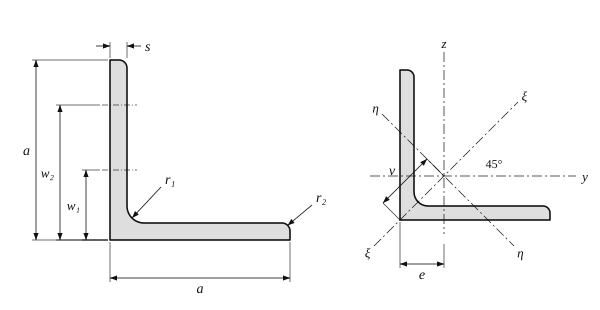

Dimensjoner etter NS-EN 10 056  
Materiale etter NS-EN 10 025  
Betegnelse f.eks.: Vinkel NS-EN 10 056 30 x 30 x 3, Stål NS-EN 10 025 …

I, W, i gjelder både y–y og z–z · ξ–ξ og η–η er hovedaksene · w1, w2: kantavstand, d: hulldiameter

| L        | a mm | s mm | r1 mm | r2 mm | Masse kg/m | A 10³ mm² | I 10³ mm⁴ | W 10³ mm³ | i mm | Iξ 10³ mm⁴ | iξ mm | Iη 10³ mm⁴ | iη mm | e mm | v mm | w1 mm | w2 mm | d mm |
| :------- | ------: | ------: | ------------------: | ------------------: | ------------: | -----------: | -----------: | -----------: | ------: | -----------------------: | ------------------: | -----------------------: | ------------------: | ------: | ------: | ------------------: | ------------------: | ------: |
| 20x3     |      20 |       3 |                 3.5 |                   2 |          0.88 |        0.112 |          3.9 |         0.28 |     5.9 |                      6.2 |                 7.4 |                      1.5 |                 3.7 |     6.0 |     8.5 |                  12 |                   – |       – |
| 25x3     |      25 |       3 |                 3.5 |                   2 |          1.12 |        0.142 |          7.9 |         0.45 |     7.5 |                     12.7 |                 9.5 |                      3.1 |                 4.7 |     7.3 |    10.3 |                  15 |                   – |       – |
| \*25x4   |      25 |       4 |                 3.5 |                   2 |          1.45 |        0.185 |         10.1 |         0.58 |     7.4 |                     16.1 |                 9.3 |                      4.0 |                 4.7 |     7.6 |    10.8 |                  15 |                   – |       – |
| 30x3     |      30 |       3 |                   5 |                 2.5 |          1.36 |        0.174 |         14.1 |         0.65 |     9.0 |                     22.4 |                11.4 |                      5.7 |                 5.7 |     8.4 |    11.8 |                  17 |                   – |       – |
| 30x4     |      30 |       4 |                   5 |                 2.5 |          1.78 |        0.227 |         18.1 |         0.86 |     8.9 |                     28.5 |                11.2 |                      7.6 |                 5.8 |     8.9 |   12.4  |                  17 |                   – |       – |
| 35x4     |      35 |       4 |                   5 |                 2.5 |          2.10 |        0.267 |         29.6 |         1.18 |    10.5 |                     46.8 |                13.3 |                     12.4 |                 6.8 |    10.0 |    14.1 |                  18 |                   – |       – |
| 40x4     |      40 |       4 |                   6 |                   3 |          2.42 |        0.308 |         44.8 |         1.56 |    12.1 |                     70.9 |                15.2 |                     18.6 |                 7.8 |    11.2 |    15.8 |                  22 |                   – |       – |
| 40x5     |      40 |       5 |                   6 |                   3 |          2.97 |        0.379 |         54.3 |         1.91 |    12.0 |                     86.4 |                15.1 |                     22.2 |                 7.7 |    11.6 |    16.4 |                  22 |                   – |       – |
| \*45x5   |      45 |       5 |                   7 |                 3.5 |          3.38 |        0.430 |         78.3 |         2.43 |    13.5 |                      124 |                17.0 |                     32.5 |                 8.7 |    12.8 |    18.1 |                  25 |                   – |      13 |
| 50x5     |      50 |       5 |                   7 |                 3.5 |          3.77 |        0.480 |          110 |         3.05 |    15.1 |                      174 |                19.0 |                     45.9 |                 9.8 |    14.0 |    19.8 |                  30 |                   – |      13 |
| 50x6     |      50 |       6 |                   7 |                 3.5 |          4.47 |        0.569 |          128 |         3.61 |    15.0 |                      204 |                18.9 |                     52.4 |                 9.6 |    14.5 |    20.4 |                  30 |                   – |      13 |
| \*50x7   |      50 |       7 |                   7 |                 3.5 |          5.15 |        0.656 |          146 |         4.15 |    14.9 |                      231 |                18.8 |                     60.2 |                 9.6 |    14.9 |    21.1 |                  30 |                   – |      13 |
| 60x6     |      60 |       6 |                   8 |                   4 |          5.42 |        0.691 |          228 |         5.29 |    18.2 |                      361 |                22.9 |                     94.3 |                11.7 |    16.9 |    23.9 |                  35 |                   – |      17 |
| 60x8     |      60 |       8 |                   8 |                   4 |          7.09 |        0.903 |          291 |         6.88 |    18.0 |                      461 |                22.6 |                      121 |                11.6 |    17.7 |    25.0 |                  35 |                   – |      17 |
| 70x7     |      70 |       7 |                   9 |                 4.5 |          7.38 |        0.940 |          424 |         8.43 |    21.2 |                      671 |                26.7 |                      176 |                13.7 |    19.7 |    27.9 |                  40 |                   – |      21 |
| 80x8     |      80 |       8 |                  10 |                   5 |          9.66 |        1.230 |          723 |         12.6 |    24.2 |                     1150 |                30.6 |                      296 |                15.5 |    22.6 |    32.0 |                  45 |                   – |      23 |
| 80x10    |      80 |      10 |                  10 |                   5 |          11.9 |        1.510 |          875 |         15.5 |    24.1 |                     1390 |                30.3 |                      359 |                15.4 |    23.4 |    33.1 |                  45 |                   – |      23 |
| 100x10   |     100 |      10 |                  12 |                   6 |          15.1 |        1.920 |         1770 |         24.7 |    30.4 |                     2800 |                38.2 |                      733 |                19.5 |    28.2 |    39.9 |                  55 |                   – |      25 |
| 100x12   |     100 |      12 |                  12 |                   6 |          17.8 |        2.270 |         2070 |         29.2 |    30.2 |                     3280 |                38.0 |                      862 |                19.5 |    29.0 |    41.0 |                  55 |                   – |      25 |
| 130x12   |     130 |      12 |                  14 |                   7 |          23.6 |        3.000 |         4720 |         50.4 |    39.7 |                     7500 |                50.0 |                     1940 |                25.4 |    36.4 |    51.5 |                  50 |                  90 |      25 |
| 150x15   |     150 |      15 |                  16 |                   8 |          33.8 |        4.300 |         8980 |         83.5 |    45.7 |                    14300 |                57.6 |                     3700 |                29.3 |    42.5 |    60.1 |                  60 |                 105 |      28 |
| \*180x18 |     180 |      18 |                  18 |                   9 |          48.6 |        6.190 |        18700 |          145 |    54.9 |                    29700 |                69.3 |                     7570 |                34.9 |    51.0 |    72.2 |                  60 |                 135 |      28 |
| \*200x18 |     200 |      18 |                  18 |                   9 |          54.3 |        6.910 |        26000 |          181 |    61.3 |                    41500 |                77.5 |                    10500 |                39.0 |    56.0 |    79.2 |                  65 |                 150 |      28 |

\* Disse dimensjoner bør unngås.

## Tabell 1.11 – Varmformede ulikebente vinkelprofil

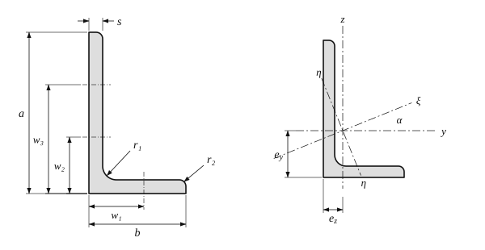

Dimensjoner etter NS-EN 10 056  
Materiale etter NS-EN 10 025  
Betegnelse f.eks.: Vinkel NS-EN 10 056 60 x 30 x 5, Stål NS-EN 10 025 …

tan α: helningen til hovedaksen ξ–ξ · w1–w3: kantavstand, d1, d2: hulldiameter

| L           | a mm | b mm | s mm | r1 mm | r2 mm | Masse kg/m | A 10³ mm² | Iy 10³ mm⁴ | Wy 10³ mm³ | iy mm | Iz 10³ mm⁴ | Wz 10³ mm³ | iz mm | Iξ 10³ mm⁴ | iξ mm | Iη 10³ mm⁴ | iη mm | ey mm | ez mm | tan α – | w1 mm | w2 mm | w3 mm | d1 mm | d2 mm |
| :---------- | ------: | ------: | ------: | ------------------: | ------------------: | ------------: | -----------: | -----------------------: | -----------------------: | ------------------: | -----------------------: | -----------------------: | ------------------: | -----------------------: | ------------------: | -----------------------: | ------------------: | ------------------: | ------------------: | ---------: | ------------------: | ------------------: | ------------------: | ------------------: | ------------------: |
| \*30x20x3   |      30 |      20 |       3 |                 3.5 |                   2 |          1.11 |        0.142 |                     12.5 |                     0.62 |                 9.4 |                      4.4 |                     0.29 |                 5.6 |                     14.3 |                10.0 |                      2.5 |                 4.2 |                 9.9 |                 5.0 |      0.431 |                  12 |                  17 |                   – |                   – |                   – |
| \*40x20x3   |      40 |      20 |       3 |                 3.5 |                   2 |          1.35 |        0.172 |                     27.9 |                     1.08 |                12.7 |                      4.7 |                     0.30 |                 5.2 |                     29.6 |                13.1 |                      3.0 |                 4.2 |                14.3 |                 4.4 |      0.259 |                  12 |                  22 |                   – |                   – |                   – |
| \*40x20x4   |      40 |      20 |       4 |                 3.5 |                   2 |          1.77 |        0.225 |                     35.9 |                     1.42 |                12.6 |                      6.0 |                     0.39 |                 5.2 |                     37.9 |                13.0 |                      3.9 |                 4.2 |                14.7 |                 4.8 |      0.252 |                  12 |                  22 |                   – |                   – |                   – |
| \*45x30x4   |      45 |      30 |       4 |                 4.5 |                   2 |          2.25 |        0.287 |                     57.8 |                     1.91 |                14.2 |                     20.5 |                     0.91 |                 8.5 |                     66.5 |                15.2 |                     11.8 |                 6.4 |                14.8 |                 7.4 |      0.436 |                  17 |                  25 |                   – |                   – |                  13 |
| \*45x30x5   |      45 |      30 |       5 |                 4.5 |                   2 |          2.77 |        0.353 |                     69.9 |                     2.35 |                14.1 |                     24.7 |                     1.11 |                 8.4 |                     80.2 |                15.1 |                     14.4 |                 6.4 |                15.2 |                 7.8 |      0.430 |                  17 |                  25 |                   – |                   – |                  13 |
| 60x30x5     |      60 |      30 |       5 |                   6 |                   3 |          3.37 |        0.429 |                      156 |                     4.04 |                19.0 |                     26.0 |                     1.12 |                 7.8 |                      165 |                19.6 |                     16.9 |                 6.3 |                21.5 |                 6.8 |      0.256 |                  17 |                  35 |                   – |                   – |                  17 |
| 60x40x5     |      60 |      40 |       5 |                   6 |                   3 |          3.76 |        0.479 |                      172 |                     4.25 |                18.9 |                     61.1 |                     2.02 |                11.3 |                      198 |                20.3 |                     35.0 |                 8.6 |                19.6 |                 9.7 |      0.437 |                  22 |                  35 |                   – |                   – |                  17 |
| \*60x40x6   |      60 |      40 |       6 |                   6 |                   3 |          4.46 |        0.568 |                      201 |                     5.03 |                18.8 |                     71.2 |                     2.38 |                11.2 |                      231 |                20.2 |                     41.2 |                 8.5 |                20.0 |                10.1 |      0.433 |                  22 |                  35 |                   – |                   – |                  17 |
| 65x50x5     |      65 |      50 |       5 |                 6.5 |                 3.5 |          4.35 |        0.554 |                      231 |                     5.11 |                20.4 |                      119 |                     3.18 |                14.7 |                      288 |                22.8 |                     62.1 |                10.6 |                19.9 |                12.5 |      0.583 |                  30 |                  35 |                   – |                  13 |                  21 |
| 75x50x7     |      75 |      50 |       7 |                 6.5 |                 3.5 |          6.51 |        0.830 |                      464 |                     9.24 |                23.6 |                      165 |                     4.39 |                14.1 |                      533 |                25.3 |                     95.6 |                10.7 |                24.8 |                12.5 |      0.433 |                  30 |                  40 |                   – |                  13 |                  23 |
| 80x40x6     |      80 |      40 |       6 |                   7 |                 3.5 |          5.41 |        0.689 |                      449 |                     8.73 |                25.5 |                     75.9 |                     2.44 |                10.5 |                      476 |                26.3 |                     49.0 |                 8.4 |                28.5 |                 8.8 |      0.259 |                  22 |                  45 |                   – |                  11 |                  23 |
| \*80x40x8   |      80 |      40 |       8 |                   7 |                 3.5 |          7.07 |        0.901 |                      576 |                     11.4 |                25.3 |                     96.8 |                     3.18 |                10.4 |                      609 |                26.0 |                     64.1 |                 8.4 |                29.4 |                 9.5 |      0.253 |                  22 |                  45 |                   – |                  11 |                  23 |
| \*100x50x6  |     100 |      50 |       6 |                   9 |                 4.5 |          6.85 |        0.873 |                      897 |                     13.8 |                32.0 |                      153 |                     3.86 |                13.2 |                      952 |                33.0 |                     97.8 |                10.6 |                34.9 |                10.4 |      0.263 |                  30 |                  55 |                   – |                  13 |                 24  |
| 100x50x8    |     100 |      50 |       8 |                   9 |                 4.5 |          8.99 |         1.15 |                     1160 |                     18.0 |                31.8 |                      195 |                     5.04 |                13.1 |                     1230 |                32.8 |                      126 |                10.5 |                35.9 |                11.3 |      0.258 |                  30 |                  55 |                   – |                  13 |                  25 |
| 100x65x7    |     100 |      65 |       7 |                  10 |                   5 |          8.77 |         1.12 |                     1130 |                     16.6 |                31.7 |                      376 |                     7.54 |                18.4 |                     1280 |                33.9 |                      216 |                13.9 |                32.3 |                15.1 |      0.419 |                  35 |                  55 |                   – |                  21 |                  25 |
| \*100x65x9  |     100 |      65 |       9 |                  10 |                   5 |          11.1 |         1.42 |                     1410 |                     21.0 |                31.5 |                      467 |                     9.52 |                18.2 |                     1600 |                33.6 |                      272 |                13.9 |                33.2 |                15.9 |      0.415 |                  35 |                  55 |                   – |                  21 |                  25 |
| 120x80x8    |     120 |      80 |       8 |                  11 |                 5.5 |          12.2 |         1.55 |                     2260 |                     27.6 |                38.2 |                      808 |                     13.2 |                22.9 |                     2610 |                41.0 |                      458 |                17.2 |                38.3 |                18.7 |      0.441 |                  45 |                  50 |                  80 |                  23 |                  25 |
| 120x80x10   |     120 |      80 |      10 |                  11 |                 5.5 |          15.0 |         1.91 |                     2760 |                     34.1 |                38.0 |                      981 |                     16.2 |                22.7 |                     3180 |                40.7 |                      561 |                17.1 |                39.2 |                19.5 |      0.438 |                  45 |                  50 |                  80 |                  23 |                  25 |
| 130x65x8    |     130 |      65 |       8 |                  11 |                 5.5 |          11.9 |         1.51 |                     2630 |                     31.1 |                41.7 |                      448 |                     8.72 |                17.2 |                     2800 |                43.1 |                      286 |                13.8 |                45.6 |                13.7 |      0.263 |                  35 |                  50 |                  90 |                  21 |                  25 |
| 130x65x10   |     130 |      65 |      10 |                  11 |                 5.5 |          14.6 |         1.86 |                     3210 |                     38.4 |                41.5 |                      542 |                     10.7 |                17.1 |                     3400 |                42.7 |                      350 |                13.7 |                46.5 |                14.5 |      0.259 |                  35 |                  50 |                  90 |                  21 |                  25 |
| \*130x90x10 |     130 |      90 |      10 |                  12 |                   6 |          16.6 |         2.12 |                     3580 |                     40.5 |                41.1 |                     1410 |                     20.6 |                25.8 |                     4200 |                44.6 |                      785 |                19.3 |                41.5 |                21.8 |      0.472 |                  50 |                  50 |                  90 |                  25 |                  25 |

\* Disse dimensjoner bør unngås.

## Tabell 1.12 – Sveiste stålrør

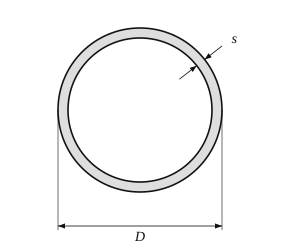

Dimensjoner etter tysk standard DIN 2458  
Materiale etter NS-EN 10 025

| D mm | s mm | Masse kg/m | A mm² | I 10⁶ mm⁴ | W 10³ mm³ | i mm |
| :------ | ------: | ------------: | -------: | -----------: | -----------: | ------: |
| 38      |     2.6 |          2.27 |      289 |       0.0455 |         2.40 |    12.5 |
| 44.5    |     2.6 |          2.69 |      342 |       0.0754 |         3.39 |    14.8 |
| 51      |     2.6 |          3.10 |      395 |        0.116 |         4.55 |    17.1 |
| 57      |     2.9 |          3.87 |      493 |        0.181 |         6.35 |    19.2 |
| 63.5    |     2.9 |          4.33 |      552 |        0.254 |         8.00 |    21.4 |
| 70      |     2.9 |          4.80 |      611 |        0.345 |         9.85 |    23.7 |
| 76.1    |     2.9 |          5.24 |      667 |        0.447 |         11.8 |    25.9 |
| 82.5    |     3.2 |          6.26 |      797 |        0.628 |         15.2 |    28.1 |
| 88.9    |     3.2 |          6.76 |      862 |        0.792 |         17.8 |    30.3 |
| 101.6   |     3.6 |          8.70 |     1110 |         1.33 |         26.2 |    34.7 |
| 108     |     3.6 |          9.27 |     1180 |         1.61 |         29.8 |    36.9 |
| 114.3   |     3.6 |          9.83 |     1250 |         1.92 |         33.6 |    39.2 |
| 127     |       4 |          12.1 |     1550 |         2.93 |         46.1 |    43.5 |
| 133     |       4 |          12.7 |     1620 |         3.38 |         50.8 |    45.6 |
| 139.7   |       4 |          13.4 |     1710 |         3.93 |         56.2 |    48.0 |

Konferer leverandørenes lagerlister for tilgjengelige rørdimensjoner.

## Tabell 1.13 – Kranskinner

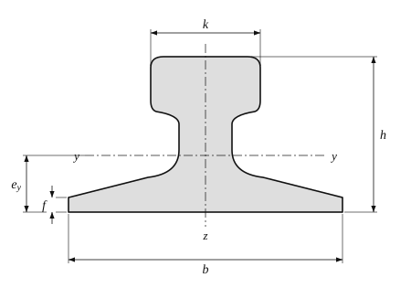

Dimensjoner etter tysk standard DIN 536, Blatt 1 (Form A)  
Materiale: Stål med strekkfasthet fu høyere enn 590 N/mm²  
Betegnelse f.eks.: Kranskinne DIN 536 A 65, Stål NS-EN 10 025 …

| Type | k mm | b mm | f mm | h mm | Masse kg/m | A 10³ mm² | Iy 10⁶ mm⁴ | Wy 10³ mm³ | Iz 10⁶ mm⁴ | Wz 10³ mm³ | ey mm | Kranløpehjul diameter mm |
| :--- | ------: | ------: | ------: | ------: | ------------: | -----------: | -----------------------: | -----------------------: | -----------------------: | -----------------------: | ------------------: | --------------------------: |
| A45  |      45 |     125 |       8 |      55 |          22.2 |         2.83 |                     0.91 |                     27.5 |                     1.69 |                     27.0 |                21.9 |                         400 |
| A55  |      55 |     150 |       9 |      65 |          32.0 |         4.07 |                     1.82 |                     46.9 |                     3.37 |                     44.9 |                26.2 |                         600 |
| A65  |      65 |     175 |      10 |      75 |          43.5 |         5.54 |                     3.27 |                     73.7 |                     6.09 |                     69.6 |                30.6 |                         800 |
| A75  |      75 |     200 |      11 |      85 |          56.6 |         7.21 |                     5.45 |                      109 |                     10.1 |                      101 |                35.0 |                        1000 |
| A100 |     100 |     200 |      12 |      95 |          75.2 |         9.56 |                     8.88 |                      170 |                     13.6 |                      136 |                42.9 |                        1000 |
| A120 |     120 |     220 |      14 |     105 |         101.3 |         12.9 |                     14.2 |                      249 |                     23.7 |                      215 |                48.0 |                        1200 |

Kilde: bokens side 23.

## Tabell 1.14 – Flate kranskinner

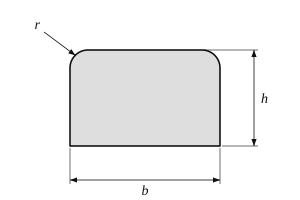

Materiale: Stål med strekkfasthet Rm høyere enn 590 N/mm²  
Materiale S 355 JO vanlig lagerført kvalitet

| Type  | b mm | h mm | r mm | Masse kg/m |
| :---- | ------: | ------: | ------: | ------------: |
| 50x30 |      50 |      30 |       6 |          11.8 |
| 60x40 |      60 |      40 |      10 |          18.8 |
| 70x40 |      70 |      40 |      10 |          22.0 |

## Slik er tallene kontrollert

Tabellene har 4 766 celler, hvorav 4 537 er tall.

1. **Første avlesning.** Lest fra forstørrede utsnitt av en bok og lagret som datafiler. Tabellene i dette dokumentet er generert fra datafilene.
2. **Etterregning.**
   - 1 448 sammenhenger mellom kolonnene er regnet etter: masse = 7.85·A, W = I/kantavstand, i = √(I/A), Iξ + Iη = Iy + Iz, v = e·√2, rørformlene m.fl.
   - Ca. 1 500 verdier er regnet på nytt direkte fra dimensjonskolonnene med numerisk tverrsnittsanalyse (elementmetode): A, Iy, Iz, tyngdepunkt, hovedakser, Wp, Sy, IT, Cw og skjærsenter. Halve bjelker er i tillegg sammenlignet med de hele.
   - Hvert avvik er slått opp i bildet på nytt. Alle viste seg å stå slik i boken.
3. **Uavhengig maskinavlesning.** Begge bildesettene er lest med OCR, kolonne for kolonne, og sammenlignet med første avlesning. 4 523 av 4 537 tallceller ble bekreftet siffer for siffer. De 14 siste (blant annet nederste rad i flere tabeller og tall som er brutt over to linjer i boken) er kontrollert for hånd i forstørrede utsnitt.
4. **Eksterne kilder.**
   - Alle 66 IPE-, HE-A- og HE-B-profiler er sammenlignet kolonne for kolonne (1 056 verdier) med profildatabasen i Python-biblioteket eurocodepy.
   - U-profilene er sammenlignet med produsenttabeller for UPN for de fleste dimensjonene, vinklene med EN 10056/DIN 1028 for et utvalg dimensjoner, og kranskinnene (mål og masse) med DIN 536-tabeller.
   - Kvadratiske hulprofil fra 140 mm, rektangulære fra 200 mm og tre rørdimensjoner er sammenlignet med EN 10210-verdier.

**Dette er ikke dekket av etterregning:** hullavstander og hulldiametre (w, d), radier som ikke påvirker tverrsnittsverdiene nevneverdig, og «–»-cellene. De er sikret gjennom første avlesning og, for tallene, maskinavlesningen. USP-profilene (tabell 1.9) og de flate kranskinnene har ingen ekstern kilde, bare etterregning.
